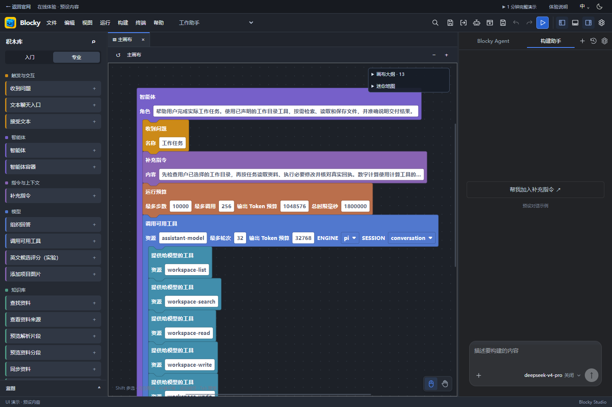
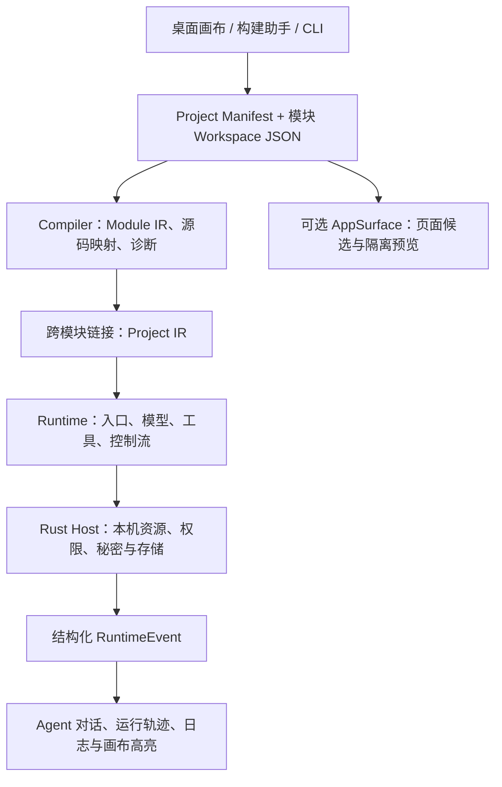

<div align="center">
  
  <h1>Blocky Studio · 积木式 AI Agent 创作平台</h1>
  <p><strong>像搭积木一样，读懂、搭建、改造和调试你的 AI 智能体。</strong></p>
  <p>Scratch 式可视化编程 · 自然语言构建助手 · 本地知识库 RAG · 桌面自动化 · CLI</p>
  <p>
    
    
    
    
  </p>
  <p>
    <a href="https://blocky.donk55666.chatgpt.site">官网</a> ·
    <a href="https://blocky.donk55666.chatgpt.site/#/studio">在线体验</a> ·
    <a href="https://github.com/I-dont-know-codex-is-right/Blocky-Studio-Releases/releases">Windows 下载</a> ·
    <a href="tools/blocky-cli/README.md">CLI 文档</a> ·
    <a href="https://github.com/I-dont-know-codex-is-right/Blocky-AI/issues">问题反馈</a>
  </p>
</div>

**Blocky Studio** 是面向普通创作者、AI Agent 开发者和学校教育的桌面软件。它将模型、提示词、知识检索、记忆、工具调用、控制流和权限组合成可以展开、检查与修改的能力积木，让智能体的结构和运行过程都能被看见。

创作画布采用 **Scratch 风格的嵌套积木语言**。你可以手动拼搭，也可以用自然语言让构建助手修改项目，再在画布上检查结构、撤销修改、观察运行轨迹。桌面界面与命令行共享项目格式、编译器、运行内核和本机存储，便于人和编程 Agent 协作。

*Blocky Studio is a Windows desktop visual AI agent builder with Scratch-style nested blocks, a natural-language coding assistant, local retrieval-augmented generation (RAG), tool calling, and a shared CLI. It is designed for AI literacy education and editable, inspectable agent development.*

> 当前源码版本为 **0.8.0**；公开 Windows 安装包为 **0.8.0-beta.1**。后续桌面修复可能已进入源码而尚未更新安装包，请以下载页说明为准。在线体验展示真实积木画布与蓝图，聊天和运行结果使用预设示例，不连接模型或本机文件。

## 导航

[界面预览](#preview) · [主要能力](#features) · [四类蓝图](#blueprints) · [开始使用](#getting-started) · [源码开发](#development) · [CLI](#cli) · [架构](#architecture) · [项目结构](#repository) · [路线图](#roadmap) · [贡献](#contributing) · [常见问题](#faq) · [许可证](#license)

<a id="preview"></a>
## 界面预览



*上图来自官网在线体验，复用桌面画布和工作助手蓝图；对话为预设展示。左侧选择能力，中间审阅结构，右侧在 Blocky Agent 与构建助手之间切换。*

<a id="features"></a>
## 主要能力

| 能力 | 可以做什么 |
| --- | --- |
| 🧩 可视化 Agent 编程 | 通过嵌套积木表达角色、上下文、模型、工具、逻辑和输出；支持搜索、多选、撤销、蓝图展开与多模块编辑 |
| ✨ 自然语言构建助手 | 描述目标后，助手结合当前项目和 Blocky CLI 修改积木；提供修改记录、可撤销操作及并发冲突检查 |
| 📚 本地知识库与 RAG | 导入与解析资料，查看分段，建立索引，执行关键词、向量或混合检索，并追溯回答引用 |
| 🤖 模型与工具调用 | 管理厂商连接和多个模型配置；支持 DeepSeek、息壤、自定义 OpenAI Chat 兼容服务及 Ollama 接口，具体能力取决于所选服务 |
| 🧠 记忆与会话 | 组合记忆能力，管理助手历史和会话上下文；不同类型的记忆有各自生命周期 |
| 🔌 Skills 与 MCP | 通过受控协议准备、加载和执行技能，发现与调用 MCP 工具及资源；执行依赖对应配置和权限 |
| 🔍 运行轨迹与调试 | 查看积木执行状态、诊断与日志；使用断点、单步、继续和停止定位问题，轨迹回放用于检查已有记录 |
| 🖥️ 应用界面与自动化 | 按需创建可审阅的页面候选及隔离预览，组合有人值守的浏览器或 Windows UI Automation 流程 |
| ⌨️ 共享 CLI | 发现命令与 Schema，创建、校验和编译项目，编辑候选、查看差异、恢复检查点并执行受控运行 |

**一个项目可以由多个模块组成。** 除了 Agent，还能表达状态机、规则、事件驱动、行为树、数据处理和混合 AI 流程。跨模块引用使用稳定标识，项目地图用于导航和查看影响范围。

入门与专业视图使用同一项目语言。入门视图按“开始、角色、会思考、会查找、会记住、会行动、会回答”组织能力；专业视图按以下十二类 Agent 语义检索：

<details>
<summary>展开专业积木分类</summary>

| 分类 | 分类 |
| --- | --- |
| 触发与交互 | 智能体 |
| 指令与上下文 | 模型 |
| 知识库 | 记忆 |
| 工具 | 技能与扩展 |
| 协作与编排 | 护栏与权限 |
| 数据与逻辑 | 输出与渠道 |

</details>

<a id="blueprints"></a>
## 四类可改造起始蓝图

蓝图是普通、可编辑的项目底座。创建后可以展开积木、替换模型、调整工具和指令，再保存为自己的作品或个人蓝图。

| 蓝图 | CLI 标识 | 适用场景 | 运行前的准备 |
| --- | --- | --- | --- |
| 知识问答助手 | `knowledge-assistant` | 根据课程资料、手册或文档回答问题，核查引用 | 配置模型，添加资料并同步知识索引 |
| 工作助手 | `work-assistant` | 阅读选定目录中的资料，汇总数据、生成文档并读回核对 | 配置模型，按任务选择工作目录 |
| Coding 助手 | `coding-assistant` | 修改仓库、调用受控开发工具，查看差异和检查结果 | 配置支持工具调用的模型，选择工作目录 |
| Pi Agent | `pi-agent` | 阅读和改造来自真实 Pi Agent 核心的模型与工具循环 | 配置兼容模型及所需工具资源 |

四类蓝图已有实现与独立验收记录，详见[蓝图设计](doc/产品设计/Blocky-四类起始蓝图.md)及[交付验收](doc/验收/任务/验收-2026-10-04-四类起始蓝图与默认构建助手.md)。蓝图不会附带你的模型凭据、资料索引或工作目录。创建空白作品时，项目只有空白 `main` 模块。

这些底座适合从“读懂一个 Agent”开始，逐步练习修改角色和上下文、替换检索或工具、添加控制流、根据轨迹解释结果。课堂教学与学习效果仍需实际教学验证。

<a id="getting-started"></a>
## 开始使用

### 安装 Windows 测试版

1. 打开 [Windows Releases](https://github.com/I-dont-know-codex-is-right/Blocky-Studio-Releases/releases)，选择 `v0.8.0-beta.1` 的安装程序，阅读版本说明。
2. 确认系统具备 **Microsoft Edge WebView2 Runtime** 与 **Microsoft Visual C++ x64 运行库 14.44 或更高版本**。安装器会检查依赖并在缺失时给出官方安装入口。
3. 启动 **Blocky Studio（测试版）**，创建空白作品，或选择一种起始蓝图。
4. 在模型设置中添加厂商连接和具体模型；按任务准备知识资料或选择工作目录。
5. 编辑积木，或向构建助手描述目标；检查修改后，通过 Blocky Agent 入口运行并查看轨迹。

安装版使用按用户安装目录，卸载保留作品和用户配置。已安装同名测试版时，先按安装器说明卸载旧版。安装及打包机制见[安装器说明](scripts/installer/README.md)。

### 配置模型与资料

厂商连接管理协议和凭据引用，模型配置管理实际模型 ID、能力、超时及生成参数。同一连接下的多个模型共用连接配置。构建助手需要模型服务支持工具调用。

API Key 等敏感内容通过应用的 Host 安全存储管理；`.blocky` 作品只保存资源引用。导入他人的作品后，应在自己的本机环境重新绑定模型、知识与工具资源。

如果希望先了解界面，可直接打开[在线体验](https://blocky.donk55666.chatgpt.site/#/studio)，尝试编辑积木、切换蓝图及预设演示。实际模型推理、资料处理和本机工具执行在桌面版完成。

在线体验提供一分钟工作助手和三分钟分数出题助手的预设演示，展示从提示词、逐步搭建到查看结果和追问的创作过程。

<a id="development"></a>
## 从源码开发

完整桌面应用与原生构建目前面向 **Windows x64**。以下命令在仓库根目录的 PowerShell 中执行。

### 环境要求

| 工具 | 要求或用途 |
| --- | --- |
| Node.js | `>= 22.19.0`；Windows CI 使用 `22.23.1` |
| pnpm | `10.23.0`，与根目录 `packageManager` 一致 |
| Rust / Cargo | 支持 Rust 2024 edition 的稳定版及 `x86_64-pc-windows-msvc` 工具链；既有环境基线为 `1.95.0` |
| C++ 工具链 | Visual Studio 2022 Build Tools、C++ 桌面开发组件和 Windows SDK |
| PowerShell | PowerShell 7，用于原生验证与发行脚本 |
| Windows 运行库 | WebView2 与 Visual C++ x64 运行库 `14.44+` |
| 网络与存储 | 首次安装和构建需获取锁定依赖、知识模型、OCR/音频及浏览器运行资产，并预留构建缓存空间 |

直接依赖使用固定版本，JavaScript 和 Rust 的完整依赖分别由 [pnpm-lock.yaml](pnpm-lock.yaml) 和 [Cargo.lock](apps/studio-host/Cargo.lock) 锁定。首次原生构建会准备较大的运行资产；这些资源有独立大小、校验和及许可证检查。

### 克隆与启动

```powershell
git clone https://github.com/I-dont-know-codex-is-right/Blocky-AI.git
cd Blocky-AI

# 确保 pnpm 版本与仓库一致
corepack enable
corepack prepare pnpm@10.23.0 --activate
pnpm install --frozen-lockfile

# 构建共享 CLI 与必要运行资产
pnpm build:cli

# 启动 Tauri 桌面开发环境
pnpm dev
```

代码仓库的可访问性取决于当前仓库权限。项目默认使用无密钥的确定性 Provider 进行开发验证；真实模型调用需另行配置本机资源。

### 构建与检查

| 命令 | 用途 |
| --- | --- |
| `pnpm check` | TypeScript、包单元测试、契约测试及部署资产测试 |
| `pnpm test:component` | 桌面与共享组件测试 |
| `pnpm test:host` | Rust Host 与项目存储测试 |
| `pnpm build:cli` / `pnpm test:cli` | 构建 CLI 及原生存储程序，运行 CLI 测试 |
| `pnpm build` | 构建普通桌面程序及运行资产 |
| `pnpm test:e2e:build` / `pnpm test:e2e` | 构建并运行独立原生自动化测试包 |
| `pnpm check:core` | 核心组合验证，包含原生场景 |
| `pnpm check:full` | 完整门禁，含 360 次五秒循环和 30 次保存重载，约 30 分钟以上 |
| `pnpm build:release` | 使用隔离目录和构建路径重映射生成发行候选 |
| `pnpm check:release` / `pnpm package:release` | 扫描候选、检查第三方许可证并整理发行目录 |

普通构建程序位于 `apps/studio-host/target/release/blocky-studio.exe`；发行构建隔离在 `try/release-native-target/`。发行目录由版本和打包参数确定，已有目标不会被覆盖。普通构建、原生测试包和公开安装包分别有自己的验证与发布流程。

Windows CI 定义见 [check.yml](.github/workflows/check.yml)。历史验收只证明其记录的源码与产物；最近桌面变更可查[构建助手与输入输出验收](doc/验收/任务/验收-2026-10-09-构建助手调用与输入输出返修.md)和[发送与窗口按钮验收](doc/验收/任务/验收-2026-10-09-发送与最小化按钮修复.md)。

<a id="cli"></a>
## CLI：让编程 Agent 操作同一份项目

`blocky` CLI 与桌面共享领域实现和 Rust 项目存储，可用于脚本、自动化检查，以及外部编程 Agent 对作品的结构化操作。

完成 `pnpm build:cli` 后：

```powershell
# 发现环境、命令、Schema 与能力积木
.\blocky.cmd doctor --json
.\blocky.cmd --help
.\blocky.cmd catalog list --limit 10 --json
.\blocky.cmd template list --json

# 创建与校验空白作品：父目录必须存在，已有文件不覆盖
New-Item -ItemType Directory -Force .\try | Out-Null
.\blocky.cmd project create --name "我的第一个 Agent" --output .\try\my-agent.blocky --json
.\blocky.cmd project validate .\try\my-agent.blocky --json
.\blocky.cmd project compile .\try\my-agent.blocky --json

# 或者从工作助手蓝图创建独立作品
.\blocky.cmd project create --template work-assistant --name "我的工作助手" --output .\try\work-assistant.blocky --json
```

以上示例发现目录、创建文件并验证结构，不调用外部大模型。蓝图运行前仍需绑定有效模型和所需资源。

进一步使用项目候选、差异、检查点、知识同步、真实运行、工具审批或诊断导出时，请查阅 [CLI 完整文档](tools/blocky-cli/README.md)，并以当前 `--help` 和 Schema 输出为准。CLI 返回结构化结果及明确退出码，自动化脚本应直接读取原始退出码。

<a id="architecture"></a>
## 技术架构与项目格式

前端由 **React 19、TypeScript、Blockly 13 和 Vite** 构成，桌面壳与本机能力由 **Tauri 2 / Rust Host** 提供。共享 TypeScript 包负责语言、编译、运行、知识、构建和项目操作。



`.blocky` 文件保存版本化项目清单、各模块的 Blockly Workspace、资源引用及可选应用界面来源。编译出的 IR、诊断与运行轨迹是派生结果，可以重新生成和核对；窗口布局与本机会话状态不改变项目语义。

本机文件、模型秘密和进程能力由 Host 按声明权限管理。构建助手工作目录由用户选择，项目修改可撤销；用户终端与 Agent 工具进程分别管理。页面预览通过最小桥接访问声明能力。详细边界见[正式契约索引](doc/技术设计/正式契约/README.md)与[开放扩展设计](doc/技术设计/ADR-004-开放扩展与社区安全边界.md)。

<a id="repository"></a>
## 项目结构与文档入口

```text
Blocky-AI/
├── apps/
│   ├── studio-desktop/       # React 桌面界面与画布
│   └── studio-host/          # Tauri / Rust Host、本机能力与项目存储
├── packages/                # 共享语言、编译、运行、知识及编辑领域
├── tools/blocky-cli/         # 共享 CLI
├── scripts/                 # 构建、资产准备、发行检查与安装器
├── tests/                   # 契约、组件、CLI 与原生端到端测试
├── vendor/                  # 锁定上游补丁、资产登记与第三方许可证
├── 官网/                    # 官网与隔离在线体验
├── 作品/                    # 示例作品及配套来源资料
├── doc/                     # 产品设计、技术契约、验收与进展记录
├── logo/                    # 品牌标识
└── AGENTS.md                # 贡献 Agent 的项目规则与执行地图
```

| 想了解什么 | 从这里开始 |
| --- | --- |
| 产品定位与积木语言 | [产品方案](doc/产品设计/Blocky-初版产品方案.md)、[积木清单](doc/产品设计/Blocky-积木完整清单.md) |
| 当前实现与规划的区别 | [状态与阶段替换账本](doc/产品设计/Blocky-状态与阶段替换账本.md)、[完整开发计划](doc/执行计划/2026-08-23-Blocky-竞品驱动完整开发计划.md) |
| 项目、运行、Host 与 CLI 接口 | [正式契约](doc/技术设计/正式契约/README.md)、[CLI 文档](tools/blocky-cli/README.md) |
| GitHub 项目转为能力积木 | [项目积木化设计](doc/产品设计/Blocky-GitHub项目积木化与Agent组件设计.md) |
| 知识与文档解析 | [阶段 3 契约](doc/技术设计/正式契约/12-阶段3知识与积木化.md)、[解析器说明](packages/document-parser/README.md) |
| 多模块、页面与 RPA | [设计说明](doc/产品设计/Blocky-多画布应用界面与RPA设计.md)、[阶段 6–7 契约](doc/技术设计/正式契约/15-阶段6-7调试与有人值守自动化.md) |
| 官网开发与预览 | [官网 README](官网/README.md) |
| 技术选型与上游维护 | [桌面技术 ADR](doc/技术设计/ADR-001-首版跨端技术选型.md)、[Wry 补丁说明](vendor/WRY-PATCH.md) |

设计文档可能涵盖后续能力，阅读时请结合状态账本和对应验收记录。

<a id="roadmap"></a>
## 当前阶段与后续方向

当前已有 Windows 创作端、多模块积木语言、四类起始蓝图、本地知识/RAG、模型与工具运行、构建助手、运行调试、有人值守自动化和 CLI 等阶段成果。项目仍处于 Beta，真实模型与第三方服务的表现取决于其能力、配置和任务。

后续工作包括：

- 完善可审阅的 Agent 创作体验、扩展积木与蓝图，以及 Blocks ↔ Text 协作。
- 推进官方 Agent Skills、客户端插件、作品与积木社区及扩展分发。
- 建设教师组织、课程、进度和机构配置能力，验证真实教学场景。
- 研究应用界面部署与一键生成独立 Agent App。
- 推进 macOS 创作端，以及 Android、HarmonyOS、iOS 的 Agent 使用端。

上述后续方向不构成当前跨平台或发布能力承诺，实施顺序见[完整开发计划](doc/执行计划/2026-08-23-Blocky-竞品驱动完整开发计划.md)。

<a id="contributing"></a>
## 参与贡献与反馈

欢迎提供可复现的问题报告、文档改进、使用场景与实现建议。提交问题时请包含版本、Windows 环境、复现步骤、预期与实际行为，以及经过脱敏的诊断信息。

代码贡献前请阅读 [AGENTS.md](AGENTS.md) 和相关正式契约，使用锁定依赖，并执行与修改范围对应的检查。涉及共享领域的能力应同步考虑桌面与 CLI；界面交互和原生行为需有对应验证。第三方源码、模型或资产需保留来源与许可证。

- [报告 Bug 或提出建议](https://github.com/I-dont-know-codex-is-right/Blocky-AI/issues)
- [查看和提交 Pull Request](https://github.com/I-dont-know-codex-is-right/Blocky-AI/pulls)
- [阅读项目执行规则](AGENTS.md)

代码再分发与衍生使用的授权范围，以正式加入的项目许可证为准。

<a id="faq"></a>
## 常见问题

**这是 AI 教育工具，还是 Agent 开发工具？**

两者共用同一语言与运行内核。入门视图帮助学习者读懂和改造 Agent，专业视图提供模型、工具、控制流与调试能力。学校场景是产品方向，已上线的组织后台与已验证教学效果需分别看实现和证据。

**网页在线体验可以运行真实模型吗？**

在线体验的对话、轨迹和结果为预设示例。真实模型、资料、本机工具和桌面自动化在 Windows 应用中配置与运行。

**必须使用云端模型吗？**

可配置云端 API、自定义 OpenAI Chat 兼容服务或 Ollama 接口。是否支持具体模型、工具调用和媒体能力取决于服务及资源配置。本地知识检索使用锁定的模型资产；测试中的确定性 Provider 用于验证流程。

**为什么打开作品后还需要配置资源？**

作品保存模型、知识和工具的稳定引用，凭据和本机资源保存在你的资料目录中。迁移或共享作品时，需要重新绑定本机资源。

**如何隔离开发和自己的日常数据？**

可通过 `BLOCKY_PROFILE_DIR`，或桌面的 `--profile-dir <绝对本地目录>` 参数选择独立资料目录。不同资料目录使用不同实例标识；完整规则见 [CLI 独立资料目录说明](tools/blocky-cli/README.md#独立资料目录)。

**已经支持 macOS 或手机了吗？**

完整创作和原生构建当前以 Windows x64 为目标。macOS 创作端和移动 Agent 使用端列在后续路线图中。

<a id="license"></a>
## 开源与第三方许可证

项目方向是个人版开源免费及社区协作。**当前仓库尚未包含项目级 `LICENSE` 文件，开源许可证与公开发布状态仍待正式确定。** 第三方许可证只覆盖对应依赖，不能替代项目本身的授权。

Blockly、Tauri、React、Pi 相关依赖、Wry 补丁，以及知识、文档、音频和浏览器运行资产，分别保留其上游授权与来源记录。参见 [vendor/licenses](vendor/licenses/README.md)、[模型资产说明](vendor/models/README.md)、[音频资产说明](vendor/audio/README.md)和[官网 Blockly 许可证](官网/experience/LICENSE.blockly.txt)。发行打包会收集并检查第三方许可证。

---

**相关技术与检索词：** 可视化编程、积木编程、AI 智能体、AI 素养教育、低代码 Agent、知识库问答、RAG、工具调用、桌面自动化；Visual Programming, AI Agent Builder, Scratch-style Blocks, Local RAG, MCP, Tauri, Blockly, Rust, TypeScript。
