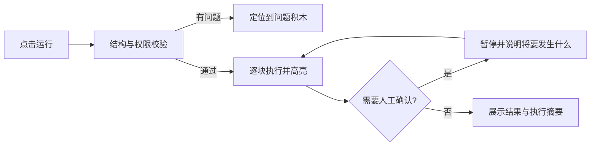

# Blocky 初版产品方案

| 项目 | 内容 |
|---|---|
| 版本 | v0.1 |
| 日期 | 2026-08-09 |
| 状态 | 初版，可用于进入交互原型与技术验证 |
| 首阶段平台 | Windows、Android、HarmonyOS |
| 后续平台 | macOS、iOS |

## 1. 产品定义

### 一句话定位

> 像搭积木一样，创造并看懂自己的 AI 伙伴。

Blocky 不是把 Dify、n8n 一类节点图换成更鲜艳的方框，也不是只让用户输入一句话后得到一个不可理解的黑盒 Agent。它提供一套接近 Scratch 的视觉语言：积木的形状、嵌套关系和连接规则本身表达程序含义；自然语言可以帮助生成积木，但积木程序始终是用户可查看、可修改的事实来源。

### 核心体验

1. 用户可以从教程、模板、自然语言描述或空白画布开始。
2. Blocky 把意图转成可读的能力积木，明确显示触发条件、输入、判断、行动和权限。
3. 不兼容的积木无法错误拼接；缺少参数、权限或模型时，在对应积木上直接说明。
4. 运行时，执行中的积木依次亮起，输入、输出、等待确认和错误都能定位到具体积木。
5. 用户可以复制、改造和分享作品，而不是重新写一段难以维护的 Prompt。

### 明确不做

- 不做浏览器可访问的 Web 客户端。
- 不把“节点 + 连线 + JSON 参数面板”作为主交互。
- 不在首版追求企业级多 Agent 编排、海量连接器或任意代码执行。
- 不让 AI 生成的隐藏流程绕过用户在画布中看到的积木。

## 2. 目标用户与首要场景

### 教育版

首批默认面向 12 岁以上学生、中职/高校入门课程及授课教师。首版重点不是学校管理后台，而是让学生在一节课内理解“输入—思考—判断—行动—检查”这条 AI 程序链。

首要场景：

- 跟随分步教程完成第一个 AI 作品。
- 修改示例中的条件、提示和输出，观察结果差异。
- 使用模拟模型完成无账号、无密钥的课堂练习。
- 在教师允许的模型和能力范围内运行真实 AI。

### 专业版

首批面向个人创作者、AI 重度用户、小团队运营人员和希望精确控制 AI 行为的非开发者。

首要场景：

- 从一句需求生成可解释的积木草稿。
- 使用文件、结构化输出、持久记忆等高级积木构建个人 AI 助手。
- 逐步调试、查看每步输入输出，并在敏感操作前人工确认。
- 从积木社区安装经过审核的积木包和模板。

### 暂不作为首批目标

- 小学低龄用户及其完整未成年人合规体系。
- 需要 SLA、审计中心和复杂组织权限的企业客户。
- 需要开放 SDK、任意插件代码和商业分成的第三方开发者。

## 3. 品牌起点

- 品牌名固定为 `Blocky`。
- 当前工作区素材 `logo/logo.png` 为蓝色拟人积木与黄色圆角底板的图标概念，可作为后续视觉探索的母图。
- 该 PNG 为 1254 × 1254、无透明通道的概念图，不直接当作最终商店资源；Windows、Android、HarmonyOS、macOS 和 iOS 均需按平台规范重新裁切、留安全区并导出。
- 在 16、24、32、48、64、128、256 和 512 像素下检查眼睛、嘴部、顶部凸点与轮廓的辨识度；Android/HarmonyOS 还需验证系统蒙版裁切。
- 未选择新的视觉方向前，只围绕该母图做规范化，不重新发明吉祥物或配色。

## 4. 产品术语

| 用户可见名称 | 技术名称 | 含义 |
|---|---|---|
| 能力积木 | Capability Block | 最小可拼接能力，例如“询问用户”“让 AI 判断” |
| 积木包 | Block Pack | 可安装、可版本化的一组能力积木及其资源 |
| 积木库 | Block Library | 当前版本可使用的全部积木集合 |
| 积木社区 | Blocky Community | 发现、审核、安装积木包和模板的入口 |
| 作品 | Blocky Project | 教育场景的项目称呼 |
| AI 程序 | Block Program | 专业场景的项目逻辑称呼 |
| 执行台 | Run Stage | 运行、单步查看、确认和定位错误的区域 |
| AI 伙伴 | Agent | 面向普通用户的 Agent 称呼；专业界面可同时显示 Agent |

“模块”只作为泛称，不作为正式产品对象名称，避免它同时指积木、插件、连接器和代码模块。

## 5. 教育版与专业版

### 共同原则

- 共用一套代码库、项目格式、积木语言、运行内核和安全模型。
- 版本差异来自教程、积木目录、权限策略和授权权益，不维护两套互不兼容的编辑器。
- 专业版作品在教育版打开时必须完整保留；受限积木显示锁定原因，不得被删除或静默降级。
- 教育版作品可以无损转到专业版继续编辑。

### 版本差异

| 能力 | 教育版 | 专业版 |
|---|---|---|
| 基础积木与执行台 | 完整 | 完整 |
| 引导教程 | 核心能力，分步讲解与任务检查 | 提供快速上手，不强制 |
| 模型使用 | 模拟模型；学校配置的受控模型 | 用户自备模型配置；后续可选 Blocky 托管额度 |
| 积木目录 | 精简、按课程逐步开放 | 完整目录与高级积木包 |
| 调试 | 结果解释、错误定位、单步运行 | 增加结构化输入输出、运行日志导出和高级诊断 |
| 连接器 | 首版不开放；后续为课堂白名单 | 后续开放文件、搜索、消息等连接器 |
| 积木社区 | 浏览教师精选模板；首版不上线 | 后续支持安装、收藏、发布和 Remix |
| 原生 Agent 兼容模板 | 后续可提供只读结构讲解和安全课程样例 | 内置 OpenClaw、Hermes 模板；连接或托管官方运行时 |
| 管理能力 | 后续加入课堂、作业和教师策略 | 后续加入个人同步与团队空间 |
| 商业方式 | 学校/课程授权，方案后定 | 高级功能授权；模型成本与软件权益分开 |

首个 MVP 不收费，只实现可测试的“教育/专业模式”和权益边界，避免在核心体验尚未验证前投入支付与许可证系统。

## 6. Blocky 视觉语言 v0.1

### 设计原则

- **人话优先**：显示“让 AI 判断这段话是否紧急”，而不是 `LLM Classifier Node`。
- **形状即语义**：事件、动作、值、条件和容器使用不同连接形状，错误组合无法吸附。
- **细节渐进呈现**：积木正面只放核心句子；模型、格式、重试等高级参数进入详情面板。
- **所见即执行**：运行内核只执行画布编译出的版本化程序，不执行隐藏 Prompt 流程。
- **先解释后放权**：外部访问、持久记忆和有副作用的行动必须展示权限与确认点。

### MVP 基础积木

| 类别 | 首批积木 | 作用 |
|---|---|---|
| 开始 | 当点击运行 | 唯一首版触发方式，规避后台任务复杂度 |
| 输入 | 询问用户、使用文本 | 获得运行输入或常量 |
| AI | 让 AI 完成、让 AI 判断 | 生成内容或返回布尔判断 |
| 控制 | 如果/否则、重复最多 N 次 | 表达分支和有上限的循环 |
| 数据 | 记住到本次运行、读取结果 | 传递本次运行中的值 |
| 人工 | 请求我确认 | 在继续行动前暂停并等待用户 |
| 输出 | 显示结果 | 在执行台呈现最终结果 |
| 安全 | 检查结果、如果失败 | 校验输出并给出可见失败路径 |

专业版后续高级积木包括：文件读取、结构化数据、持久记忆、计划触发、外部连接器、并行、子程序、多 Agent、重试/降级、评估和受控发布。它们不得进入首个技术闭环。

OpenClaw 与 Hermes 模板属于“官方原版运行时兼容层”，不是普通积木包，也不把其任意工具能力直接塞入 Blocky 核心运行内核。具体边界见[《内置兼容模板：OpenClaw 与 Hermes》](内置兼容模板-OpenClaw与Hermes.md)。

### 类型与权限

每个积木声明输入类型、输出类型、所需能力和潜在副作用。首版至少区分：`文本`、`数字`、`真假`、`列表`、`结构化数据`、`AI 结果`。

以下操作未来必须默认经过显式确认：发送消息、提交表单、支付、删除、公开发布、写入外部系统。首版虽不实现这些连接器，但权限模型和项目格式必须预留。

## 7. 核心界面与流程

### 桌面端

- 左侧：积木库，可按“开始、输入、AI、控制、数据、人工、输出、安全”浏览。
- 中间：积木画布，支持拖拽、嵌套、缩放、撤销/重做和问题标记。
- 右侧：执行台，展示输入、逐步执行、模型输出、确认请求和错误解释。
- 顶部：项目名、教程进度、教育/专业模式提示、保存和运行。

### 手机端

- 画布与执行台使用全屏焦点模式切换，积木库从底部抽屉打开。
- 点选积木后从底部打开参数面板，避免横向挤压。
- 支持双指缩放、长按拖动、自动吸附和“定位当前执行积木”。
- 平板/折叠屏展开为接近桌面端的双栏或三栏布局。

### 三条创建路径

1. **教程创建**：按步骤高亮可用积木，完成条件由程序结构自动检查。
2. **自然语言创建**：用户描述目标，AI 生成积木草稿并标出假设；用户可逐块修改。
3. **手动创建**：从空白画布或模板开始，适合教学和精细控制。

### 运行流程



## 8. 首个 MVP 范围

### 必须完成

- Windows、Android、HarmonyOS 均能安装并打开同一类 Blocky 项目。
- 新建、保存、另存、打开、导入、导出和自动恢复。
- 上述基础积木、类型约束、必填项校验和循环上限。
- 手动运行、停止、单步观察、当前积木高亮和错误定位。
- 一个确定性模拟模型，以及一个用户自备配置的 OpenAI 兼容模型适配器。
- 模型密钥进入系统安全存储，绝不写入项目文件、日志或前端持久存储。
- 中文界面与可扩展的国际化结构。
- 教育模式的 3 节内置教程：第一次 AI 回复、条件判断、人工确认。
- 专业模式的高级参数面板与本地运行日志导出。
- 项目文件跨三端往返后，程序语义保持一致。

### 明确延期

- macOS、iOS 正式构建与发布。
- 登录、云同步、付费、订阅和模型额度代充。
- 公开积木社区、第三方发布、商业分成和任意代码插件。
- 邮箱、飞书、微信、浏览器自动化等真实连接器。
- 后台定时运行、系统常驻和跨设备自动执行。
- 团队协作、教师后台、班级、作业与数据看板。
- 多 Agent、RAG、向量数据库和复杂长期记忆。
- OpenClaw、Hermes 原生运行时的托管、版本适配与完整兼容验收；该能力在基础闭环稳定后作为独立专业版阶段实施。

## 9. 首版样例作品

默认样例为“消息分类小助手”，三端可使用同一文件运行：

```text
当点击运行
  询问用户 [粘贴一条消息]
  让 AI 判断 [这条消息是否紧急]
  如果 [是]
    请求我确认 [是否生成处理建议]
    让 AI 完成 [给出三条处理建议]
  否则
    让 AI 完成 [用一句话总结]
  检查结果 [不能为空]
  显示结果
```

模拟模型提供固定结果用于课堂和自动测试；真实模型用于人工验收，但不作为结构测试通过的前提。

## 10. 数据、安全与学校场景底线

- 默认本地保存项目和执行记录；没有账号也能完成核心闭环。
- 项目导出前清楚列出所需模型、权限和高级积木，不携带任何密钥。
- 教育模式默认关闭行为追踪；未来学校遥测必须可配置、可说明、最小化。
- 模型请求在发送前显示将离开设备的数据类别；敏感行动采用最小权限和再次确认。
- 社区积木包首发阶段只能声明受控能力，不允许携带任意原生代码或静默联网逻辑。
- AI 生成积木后必须再次通过与手工编辑相同的类型、权限和循环校验。

## 11. 验证目标

### 产品假设

- 新用户通过教育教程可在 10 分钟内完成并解释第一个作品。
- 专业用户从模板出发可在 5 分钟内完成一次可见、可修改的 AI 运行。
- 用户能从执行高亮中指出当前步骤、失败位置和下一步行动。

### MVP 验收门槛

- 三端都能完成“创建—编辑—校验—运行—保存—重开”的相同样例。
- 100 个积木的测试项目可以完成拖动、缩放、保存和运行，不出现数据丢失或无法继续操作。
- 错误拼接、缺少参数、循环超限、模型未配置和用户拒绝确认均有可定位结果。
- 项目中不含 API Key、Token、Cookie 或设备私有路径。
- 教育版打开含专业积木的作品时，完整保留未知与锁定内容。

## 12. 当前默认与待确认项

本方案先采用以下可调整默认值，不阻塞技术验证：

- 教育版首批年龄段为 12 岁以上，不先做低龄儿童产品。
- MVP 以无账号、本地项目、手动运行为主。
- 专业版优先服务个人创作者和运营人员，不先做企业平台。
- 模型使用“模拟模型 + 用户自备 OpenAI 兼容接口”，暂不建设 Blocky 云端模型网关。
- Windows 是完整编辑体验的第一优先级；手机保证完整核心闭环，并针对小屏调整交互。
- `Blocky` 品牌名已确定；以当前 `logo/logo.png` 为图标概念母图，正式资源需要单独规范化与验收。

下一阶段只需先做技术尖峰与一个交互原型，不应提前扩展社区、连接器或学校后台。

## 13. 内置原生兼容模板

专业版内置两个旗舰模板：OpenClaw 与 Hermes。用户打开模板后看到的是按原项目概念组织的能力积木，包括 Agent、模型、工具、技能、记忆、会话、消息渠道、定时任务、权限和扩展等；运行行为仍由对应官方原版运行时负责。

这里的“百分百继承”是严格兼容目标，而不是未经验证的宣传语：

- Blocky 不重写两套 Agent 内核；Windows 端托管固定版本的官方运行时，或连接用户已有实例。
- 原生配置、技能、插件与未知字段必须导入后完整保留，并能导回对应原生格式。
- 新增但尚未图形化的原生能力以“原生设置/原生步骤”积木保存，不能静默删除或降级。
- 只有某个明确上游版本通过配置往返、行为对照和扩展兼容测试后，界面才显示“已验证完全兼容”。
- Android 与 HarmonyOS 首版作为远程控制和编辑端，连接 Windows 或服务器上的官方运行时；不承诺在手机内重写或完整托管两套桌面级运行环境。

完整产品规则与分期见[《内置兼容模板：OpenClaw 与 Hermes》](内置兼容模板-OpenClaw与Hermes.md)，技术决策见[ADR-002](../技术设计/ADR-002-原生Agent兼容运行时.md)。
