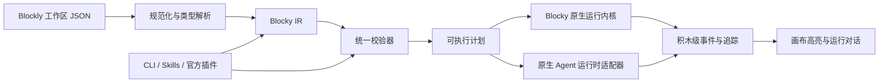

# Blocky 完整积木与 Agent 兼容设计

| 项目 | 内容 |
|---|---|
| 版本 | v0.2 设计基线 |
| 日期 | 2026-08-09 |
| 状态 | 已确认的当前方案；继续评审时在此基础上修订 |
| 当前实施边界 | 只定义完整产品与核心语义，不作为直接编码计划 |
| 配套清单 | [《Blocky 积木完整清单》](Blocky-积木完整清单.md) |

## 1. 设计目标与顺序

Blocky 先完成一套不受订阅限制的完整积木产品，再根据已经存在且通过验收的能力切分教育基础版、教育拓展版和专业版权益。订阅价格和账号规则可以预先记录，但不能反向导致核心积木缺失、项目格式分裂或运行内核分叉。

完整产品必须满足以下目标：

- 非技术用户能像使用 Scratch 一样，通过可嵌套、可约束、可逐步高亮的积木搭建 Agent。
- 一个作品可以组成单 Agent、主从 Agent、对等 Agent、流水线、群聊、辩论组、动态团队或 Agent 集群；产品不预设拓扑。
- 基础积木足够细，可表达主流 Agent 框架的共同语义；组合积木负责降低学习成本，而不是隐藏不可编辑的黑盒。
- 图形页、Blocky IR、运行内核、CLI、官方 Skills、官方插件和逆向转换器共享同一事实来源。
- 无法稳定积木化的内容必须保留为可定位的原生设置或自定义代码积木，不能猜测、静默删除或伪装成完整转换。
- 积木、组合积木和模板允许用户自定义，并可在 Blocky 社区上传、下载、版本化、派生和更新。

本设计是总设计。实施前必须拆成独立、可验收的子规格：Core 技术尖峰、积木语言与 IR、Windows 编辑器、运行内核与聊天、扩展与社区、原生兼容、CLI/Skills/插件、账号与商业权益。任何单一实施计划不得把这些独立系统一次性混在一起。

## 2. 产品形态与核心界面

- Blocky 是安装式应用，不提供浏览器 Web 入口。Windows 是第一个完整桌面版本，后续复用同一语义内核适配 Android、HarmonyOS、macOS 和 iOS。
- 整体布局接近“小猫快跑”一类 Scratch 式编辑器：左侧积木库，中间积木画布，右侧 Agent 运行对话栏。
- 右侧栏只用于与当前作品运行出的 Agent 对话，不内置“帮用户搭建积木”的辅助 Agent。
- 当作品中有多个 Agent 时，用户在运行前选择会话入口 Agent；执行过程中画布跨 Agent 高亮真实调用链。
- 外部 Codex 等编程 Agent 通过 Blocky 官方 CLI、Skills 包和插件辅助搭建。辅助行为必须在图形页显示差异并由用户掌控，不能形成隐藏流程。
- 所有用户都可以查看完整界面和受限能力。未来权益切分只控制创建、运行、导出或连接能力，不删除、不降级、不改写作品内容。

## 3. 统一语义架构



### 3.1 单一事实来源

- Blockly 工作区负责视觉布局、折叠、注释和交互状态。
- Blocky IR 负责 Agent、状态、控制流、工具、记忆、权限和运行语义。
- 校验器负责类型、连接、必填字段、依赖、权限、资源预算和兼容等级。
- 运行内核只执行通过校验的可执行计划，不执行图形页之外的隐藏 Prompt 或隐藏步骤。
- CLI 和 Agent 工具只提交版本化 Build Spec 或语义补丁，禁止直接编辑 Blockly JSON、IR 或 `.blocky` 压缩包。

### 3.2 `.blocky` 项目容器

项目容器至少保存：

- 项目清单、Schema 版本和稳定对象 ID。
- Blockly JSON 与规范化 Blocky IR。
- Agent、脚本、自定义积木、模板和资源引用。
- 积木包依赖、版本锁和来源证明。
- 原生运行时映射、未知字段保留区和兼容报告。
- 权限声明、所需能力和资源预算，不保存已经签发的临时授权。
- 可移植资源；密钥、Token、Cookie、商户密钥和设备私有绝对路径不得写入项目文件。

## 4. 项目模型与积木语法

### 4.1 Agent 是用户拼出的结构

用户可见的顶层容器称为“创建 AI 伙伴”，技术 ID 为 `core.agent.define`。它不是代码类，也不表示主 Agent 或子 Agent。容器内可以放置身份、角色、模型、指令、记忆、知识、工具、护栏、触发器和执行脚本。这里的“定义”只是“描述并创建一个可运行的 AI 伙伴”，不是要求普通用户理解类、对象或编程声明。

一个作品可以包含任意数量的 Agent 定义。Agent 之间通过调用、委派、交接、消息、广播、共享上下文和任务协议积木建立关系。主从、对等、群组、集群等结构由连接结果产生。

Blocky 不设置静态 Agent 数量上限，但每次运行必须使用明确的并发数、最大步骤、超时、模型费用、磁盘、网络和外部副作用预算。达到预算时可解释地暂停或停止，而不是损坏作品。

### 4.2 基本积木形态

| 形态 | 作用 |
|---|---|
| 事件积木 | 启动脚本，例如收到聊天消息、定时触发或收到任务 |
| 命令积木 | 执行动作，按纵向顺序连接 |
| 值积木 | 产生文本、数字、文件、消息、Agent 引用或结构化值 |
| 条件积木 | 产生真假值，只能连接到条件插槽 |
| 容器积木 | 承载分支、循环、并行、异常、权限范围或 Agent 定义 |
| 定义积木 | 定义变量、数据结构、工具、技能、子程序和自定义积木 |
| 组合积木 | 由基础积木封装，可无损展开并重新封装 |
| 注释说明块 | 保存 Markdown、教学说明和转换备注，不参与执行 |

### 4.3 原子积木与组合积木

- 原子积木只表达一个稳定语义，例如“读取状态”“调用工具”“等待 Agent 回复”。
- 组合积木把常见结构封装成人话动作，例如“让多个研究员并行搜索后汇总”。
- 组合积木必须可以展开为基础积木；展开前后输入、输出、权限、副作用、错误和追踪语义一致。
- 用户可以把一组积木封装成自定义积木，声明名称、说明、输入、输出、默认值、权限和版本。
- 模板是一组可直接实例化的积木、Agent、资源和布局；模板实例默认可继续增删和修改，不是只读成品。

### 4.4 人话表面与技术视图

- 积木正面使用简洁自然语言、类型形状和可读字段。
- 每块积木的高级下拉栏允许查看 JSON、类名、函数、底层 API、原始配置、框架字段和运行时映射。
- 技术视图修改后必须重新经过同一类型和权限校验，不能绕过图形规则。
- 同一语义的提供商差异使用下拉选项和适配元数据表达，不为每个模型或框架复制外观相同的积木。

## 5. 类型系统

Blocky 使用结构化、可扩展的强类型系统。首批类型包括：空值、文本、数字、真假、日期时间、时长、列表、集合、键值映射、记录、JSON、表格、二进制、文件、图片、音频、视频、消息、会话、流、事件、任务、计划、Agent 引用、工具引用、技能引用、记忆引用、知识库引用、密钥引用、权限、错误和结果。

连接规则：

- 完全相同或声明兼容的类型可以直接连接。
- 安全且不丢失信息的转换可以由显式转换积木完成。
- 不允许把任意结构隐式变成文本，也不允许把动态 JSON 假装成已验证记录。
- `未知` 只用于逆向导入和兼容保留；使用前必须检查、转换或交给原生适配器。
- 列表、映射、结果、流和任务支持泛型，例如 `列表<消息>`、`结果<工具输出, 错误>`。
- 结构化输出使用可视化 Schema 定义，运行时校验模型输出并提供重试、修复或失败路径。

完整类型与积木 ID 见配套清单。

## 6. 完整能力积木族

完整产品以十八个通用积木族覆盖 Agent 构建：

1. Agent 定义与模型。
2. 事件与触发器。
3. 对话、消息与多模态。
4. Prompt、上下文与模型推理。
5. 工具、连接器与开放协议。
6. 数据、变量与状态。
7. 记忆与上下文提供者。
8. 知识摄取与 RAG。
9. 控制流与工作流。
10. 多 Agent 协作。
11. 人工介入。
12. 安全、权限与护栏。
13. 代码、文件、终端、浏览器与计算机操作。
14. 持久执行、恢复与可靠性。
15. 日志、追踪、评估与成本。
16. 运行环境、部署与对外接口。
17. 自定义积木、模板、积木包与社区。
18. 原生兼容与未知内容保留。

`Blocky-积木完整清单.md` 是积木目录的表格式事实来源。产品规格只说明原则，不在多个文档复制整张目录。

## 7. Agent 运行与对话

### 7.1 三种运行路径

| 路径 | 用途 | 约束 |
|---|---|---|
| 确定性模拟 | 教程、结构测试和无模型验收 | 固定输入产生固定事件，不代表真实模型质量 |
| Blocky 原生运行 | 执行通用 IR、模型、工具、记忆和工作流 | 只执行已验证语义与已授权能力 |
| 原生兼容运行 | 托管或连接 OpenClaw、Hermes 等官方运行时 | 由版本锁定适配器投影和追踪，不重写近似内核 |

### 7.2 运行对话栏

- 用户选择入口 Agent 和会话，发送文本或多模态消息。
- 消息触发画布中的“当收到聊天消息”，真实执行积木逐步高亮。
- Agent 切换、工具调用、人工确认、流式输出、错误和恢复均显示对应积木与来源。
- 用户可以停止、单步、继续、从检查点恢复和查看完整追踪。
- 右侧栏不接受“帮我修改画布”之类搭建命令；此类任务由外部 Agent 通过官方工具完成。

### 7.3 错误与恢复

- 结构错误在运行前定位到积木和插槽。
- 运行错误返回稳定错误类型、来源积木、重试条件、已产生副作用和恢复位置。
- 并行分支分别记录成功、失败、取消和超时，汇合积木明确选择全部成功、部分成功或最先完成策略。
- 外部副作用使用幂等键、确认点和补偿积木；恢复时不得无提示重复执行已完成操作。

## 8. 自定义积木、模板与 Blocky 社区

### 8.1 可分发对象

- 纯模板：项目片段、Agent、积木和布局，仅包含数据与资源。
- 组合积木：由现有积木封装，行为可展开审查。
- 扩展积木：连接自定义代码、CLI、MCP、A2A、ACP、数据库或外部服务。
- 原生兼容包：针对明确上游版本的配置映射、事件映射和运行时适配器。

### 8.2 社区规则

- 用户可以自由上传、下载、安装、更新、派生和重新发布符合许可的积木与模板。
- 每个包必须包含稳定标识、语义版本、依赖范围、权限清单、运行环境、来源、许可证和内容摘要。
- 纯模板和组合积木可直接审查其展开内容；携带可执行代码的包必须隔离运行、数字签名、安全扫描并在安装时展示权限和副作用。
- 社区下载不等于官方背书。界面分别显示官方、已验证、社区和本地来源。
- 安装使用版本锁；更新先展示语义、权限和依赖差异，项目可以继续使用旧版本。
- 删除或下架社区内容不破坏用户已安装项目；本地保留满足许可证要求的锁定副本与来源记录。

## 9. 主流 Agent 兼容设计

### 9.1 代表性兼容语料

2026-08-09 的设计研究覆盖以下活跃或具有代表性的 GitHub 项目：

| 能力方向 | 代表项目 | 反推的共用语义 |
|---|---|---|
| 有状态图与持久工作流 | [LangGraph](https://github.com/langchain-ai/langgraph)、[Google ADK](https://github.com/google/adk-python)、[Microsoft Agent Framework](https://github.com/microsoft/agent-framework) | 状态、路由、扇出/汇合、循环、重试、嵌套、中断、检查点、恢复、人工介入 |
| 工具型与多 Agent | [OpenAI Agents SDK](https://github.com/openai/openai-agents-python)、[CrewAI](https://github.com/crewAIInc/crewAI)、[MetaGPT](https://github.com/FoundationAgents/MetaGPT)、[CAMEL](https://github.com/camel-ai/camel) | 工具调用、Agent 作为工具、委派、交接、角色、团队、SOP、群组通信 |
| 强类型与生产能力 | [PydanticAI](https://github.com/pydantic/pydantic-ai)、[Mastra](https://github.com/mastra-ai/mastra)、[Agno](https://github.com/agno-agi/agno) | 结构化输出、能力组合、中间件、记忆、定时、审批、评估、追踪 |
| 文档与 RAG | [LlamaIndex](https://github.com/run-llama/llama_index)、[Dify](https://github.com/langgenius/dify) | 摄取、解析、切片、嵌入、索引、检索、重排、引用、知识工作流 |
| 代码与持续 Agent | [smolagents](https://github.com/huggingface/smolagents)、[OpenHands](https://github.com/OpenHands/OpenHands)、[AutoGPT](https://github.com/Significant-Gravitas/AutoGPT) | 代码动作、工具动作、文件、终端、浏览器、沙箱、触发、持续运行、部署 |

项目热度不是兼容结论。正式兼容必须锁定仓库、commit、依赖和测试夹具；上游版本变化后重新验证。

### 9.2 核心积木准入

一个新语义只有满足以下任一条件才进入官方核心积木：

- 出现在至少两个相互独立的主流 Agent 项目中。
- 属于 MCP、A2A、ACP 等开放协议。
- 无法由现有积木组合表达，且是构建通用 Agent 必不可少的语义。

单一框架的类名、字段和调用方式放入高级下拉栏与适配器元数据。真正独有的行为用组合积木或扩展积木表达，不能为每个 Agent 复制一套核心积木。

### 9.3 兼容等级

| 等级 | 可声明内容 |
|---|---|
| 结构已映射 | 所有组件有对应积木、组合积木或明确的原生保留块，无静默丢失 |
| 配置可往返 | 导入后重新导出，已知与未知字段、顺序语义和依赖保持等价 |
| 行为已对照 | 固定任务的模型调用、工具、消息、状态、副作用和停止条件符合适配规则 |
| 已验证完整兼容 | 对指定上游版本同时通过结构、配置、行为、扩展和失败恢复测试 |

未达到最后一级时，界面不得使用“原版功能一致”或“完整兼容”。

## 10. OpenClaw 与 Hermes

- OpenClaw 与 Hermes 使用上述通用积木显示 Agent、模型、工具、技能、记忆、会话、消息渠道、任务、权限和扩展。
- Windows 端托管固定版本的官方运行时，或连接用户已有实例；Blocky 不重写近似内核。
- 用户可以在积木模板基础上任意增删、展开、封装和改造。
- 无法通用表达的原生字段进入技术下拉栏；无法通用执行的步骤进入可定位的原生设置或原生步骤块。
- 原生导入、Blocky 修改和导回必须保留未知字段，并通过明确版本的行为对照。
- 已确认的商业方向是将两套积木化模板纳入教育拓展权益；完整能力先实现，最终权益清单在产品完成后单独验收。

## 11. CLI、官方 Skills 包与官方插件

### 11.1 官方 Skills 包

首批工作标识固定为：

| Skill | 作用 |
|---|---|
| `$build-blocky-agents` | 使用已有积木、模板和项目结构搭建或修改 Blocky Agent |
| `$create-blocky-blocks` | 创建、验证、封装和打包自定义积木 |
| `$convert-github-project-to-blocky` | 把普通 GitHub 项目的可用能力识别为工具、数据、工作流和 Agent 积木 |
| `$reverse-agent-to-blocky` | 识别现有 Agent 项目并尽可能转换为通用积木 |

Skill 只负责编排和决策边界，所有确定性读取、映射、校验、差异、写入和验证交给 `blocky` CLI。Skill 不直接编辑 `.blocky`、Blockly JSON、IR 或原生项目。

### 11.2 逆向 Agent 工作流

```text
识别框架与版本
→ 只读扫描源码、配置、依赖和运行入口
→ 提取 Agent、工具、状态、记忆、知识、控制流和副作用
→ 查询当前 Blocky 语义目录
→ 优先映射原子积木
→ 其次生成可展开组合积木
→ 最后保留自定义代码或原生步骤
→ 生成覆盖与风险报告
→ 用户确认差异
→ 创建 Blocky 项目
→ 配置往返和固定任务行为对照
```

逆向报告必须给出通用积木化、组合积木化、自定义代码、原生保留和未转换内容，且每一项可定位到源文件、类、函数或配置字段。转换率不能代替行为等价验证。

### 11.3 图形页紧密协作

- 打开的 Blocky 应用通过本机受限 IPC 暴露当前项目、目录版本、摘要和只读运行状态。
- 外部 Agent 获取最新 `baseDigest`，提交 Build Spec 或语义补丁。
- 应用以幽灵积木、增删标记和权限变化展示差异；用户可逐块接受、全部接受或拒绝。
- 接受后由 Core 原子写入，画布立即定位新增或修改积木；外部 Agent 收到新的摘要。
- Headless CLI 使用同一协议处理文件，但涉及真实运行、外部副作用、原生写回或发布时仍需短期、单次、作用域授权。
- Codex 等客户端的 Blocky 官方插件打包 Skills、CLI 发现和本机应用连接能力，不创建第二套积木语义。

## 12. 安全与权限

- 权限按能力和对象声明：文件路径、域名、数据库、账号、消息目标、支付、发布和系统能力分别授权。
- 读取、写入、删除、公开发布、发送消息、支付和原生配置写回不能共用一个宽泛授权。
- 授权由 Blocky UI 或受信任 Host 签发，短期、单次、可撤销，并绑定项目摘要和具体动作。
- 自定义代码和社区扩展默认在隔离进程或沙箱运行；本机直接执行不能作为不受信任代码的安全边界。
- 所有模型和外部服务调用在发送前说明离开设备的数据类别。
- 追踪记录默认排除密钥、完整认证头和受保护内容；调试导出再次扫描敏感信息。

## 13. 验证策略

### 13.1 积木与 IR

- 每个积木 Schema 验证稳定 ID、输入、输出、形态、默认值、权限、错误和序列化。
- 每个积木至少有连接正例、连接反例、编译结果和运行事件测试。
- 组合积木执行“封装 → 展开 → 重新封装”语义等价测试。
- 工作区 JSON、IR、Build Spec 和 `.blocky` 执行往返与未知字段保留测试。

### 13.2 主流 Agent 兼容

- 每个兼容样本锁定仓库 commit、依赖锁、输入夹具和预期事件轨迹。
- 逆向工具必须输出结构覆盖表，不允许未报告的丢失。
- 配置往返比较已知字段、未知字段、依赖、默认值和顺序语义。
- 行为对照覆盖模型请求、工具参数、消息路由、状态迁移、人工中断、副作用、错误与恢复。
- 只有对应版本通过全部门禁才提升兼容等级。

### 13.3 编辑器与运行

- 既有最低门槛继续要求 100 个积木完成拖动、缩放、保存、运行和重开且无数据丢失。
- 产品不设置静态项目或 Agent 数量上限；更大项目使用分区画布、折叠、搜索、延迟渲染和资源预算，并通过分档基准记录实际设备边界。
- 运行对话必须与积木级事件一致，停止、断点、并行和跨 Agent 高亮不得产生幽灵步骤。
- 简体中文、繁体中文、英语和日语在第一个 Windows 开发版即完整可切换，并对积木句式、字段截断和输入法进行人工验收。

## 14. 实施分解与硬门禁

1. 在 `try/` 完成 Tauri 2、React、Blockly 和 Windows 本地 WebView 技术尖峰，验证序列化、性能、触控、IPC、流式取消和敏感信息边界。
2. 技术尖峰通过后建立共享类型、积木 Schema、IR、校验器和确定性模拟运行时。
3. 建立 Windows 正式编辑器、运行对话和本地项目闭环。
4. 实现完整通用积木族、自定义积木、模板和扩展运行边界。
5. 实现社区、版本、依赖、签名和安全检查。
6. 实现 OpenClaw、Hermes 与代表性框架的版本化适配器和兼容测试。
7. 实现 CLI、官方 Skills 包和 Codex 等客户端官方插件。
8. 完整产品通过后，再执行教育基础、教育拓展和专业权益切分与商业验收。

每一步是独立子项目，必须单独设计、计划、测试和验收。前一步的绿色结构测试不自动证明真实模型质量、原生运行时兼容、社区安全或支付上线。

## 15. 已确认但不在本规格实施的商业约束

以下规则保留为后续账号与权益规格的输入，不在核心积木阶段实现：

- 教育基础版无需登录，可完全离线使用本地基础能力；邮箱验证码用于正式账号，游客可无损绑定邮箱。
- 一个个人账号最多绑定 3 台 Windows 设备；可自行解绑旧设备。
- 专业权益包含教育拓展权益；所有用户可切换并预览教育/专业界面。
- 教育拓展：单月 ¥128、连续包月 ¥98、连续包年 ¥980。
- 专业版：单月 ¥598、连续包月 ¥520、连续包年 ¥5,200。
- 连续包月和连续包年自动续费，用户关闭后使用至当前周期结束；作品不删除，受限能力只锁定。
- 从教育拓展升级专业版时，按订单创建时的真实起止时间、真实剩余时长和实付价格计算折扣；订单过期重新计算，已经消费的折抵不得重复使用。跨订单溢出处理不进入本核心规格，单独计费规格未通过前禁止实现生产扣款。
- 最后一次联网获得的权益只离线有效到真实到期时间，不额外增加固定宽限期。
- 中国大陆首发使用人民币，计划同时支持支付宝和微信支付；目前没有企业主体和商户号，因此首个开发版本只能使用本地账号/支付沙箱，生产收款保持阻塞。
- 学校和企业采用咨询方案，按席位数、授权版本和合同有效期管理；管理员生成邀请链接或激活码，账号可同时绑定多个组织，最终取所有有效来源中的最高权益。
- 未成年人禁止独立购买，必须由监护人购买；购买页要求成年人或监护人确认，不采集身份证，不设计未成年人专项退款入口，但后台保留依法人工处理和原路退款能力。
- 第一个 Windows 开发版提供简体中文、繁体中文、英语和日语完整切换。

这些商业规则不得写入积木语义、项目格式或运行内核；权益服务只能基于能力 ID 授权。

## 16. 与既有文档的关系

- 本文取代《Blocky 初版产品方案》中关于“只做有限基础积木、暂不支持多 Agent、专业版独占 OpenClaw/Hermes”和“右侧仅为执行台”的旧阶段边界。
- [《CLI 与官方 Agent Skill》](CLI与官方Agent-Skill.md)中的摘要、Build Spec、差异与授权原则继续有效；单一 Skill 结构由本文定义的官方 Skills 包和插件扩展。
- [《内置兼容模板：OpenClaw 与 Hermes》](内置兼容模板-OpenClaw与Hermes.md)和 ADR-002 的原生运行时、未知字段保留及版本化验收原则继续有效。
- 发生冲突时，以本文及后续经用户确认的专项规格为准。
