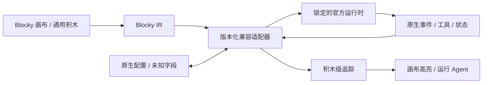

# Blocky 官方兼容模板：OpenClaw、Hermes、Pi、OpenCode 与 DeepSeek Harness

| 项目 | 内容 |
|---|---|
| 版本 | v0.3 设计基线 |
| 日期 | 2026-08-16 |
| 状态 | 已确认；尚未实现或验证真实兼容 |
| 模板范围 | OpenClaw、Hermes、Pi、OpenCode、DeepSeek Harness |
| 桌面平台 | Windows 首发完整能力；macOS 后续提供同等能力 |
| 移动平台 | Android、HarmonyOS、iOS 后续作为 Agent 使用器，经能力协商连接运行目标 |

## 1. 产品定义

五个模板都不是 Blocky 对原项目的近似重写。Blocky 托管或连接锁定版本的官方运行时，通过版本化适配器把原生配置、组件、事件和状态投影为通用积木，并在右侧 `运行 Agent` 标签页显示真实执行过程。

> 原版运行时负责其原生行为，Blocky 负责可逆积木投影、交互入口、权限、差异、运行观察和用户改造。

用户可以从模板创建普通 `.blocky` 项目，增删、展开、封装和替换任意可编辑积木。模板来源会保留，但改造后的项目不自动继续宣称与原版行为一致。

完整能力先实现和验收，五个模板的教育基础、教育拓展或专业权益归属在完整产品完成后单独切分。

## 2. 兼容声明

兼容等级按具体上游仓库、commit、依赖锁和测试夹具评定：

| 等级 | 必须满足 |
|---|---|
| 结构已映射 | 所有已知组件有通用积木、组合积木或明确原生保留块，无静默丢失 |
| 配置可往返 | 导入后导回，已知与未知字段、默认值、顺序和依赖保持等价 |
| 行为已对照 | 固定任务的模型、工具、消息、状态、副作用、停止和失败恢复符合适配规则 |
| 已验证完整兼容 | 对锁定版本同时通过结构、往返、行为、扩展、升级和恢复门禁 |

只有最后一级可以显示“与指定版本完整兼容”。“基于模板创建”“结构已映射”或“配置可往返”不能缩写成“原版功能一致”。

## 3. 共用运行架构



统一适配器协议覆盖：

- 探测安装、版本、依赖、功能和健康状态。
- 只读扫描配置、Agent、工具、Skill、插件、会话和资源。
- 把原生对象映射为通用积木、适配器元数据或原生保留块。
- 启动、连接、停止、发送消息、取消、审批和恢复。
- 把原生事件映射为稳定 Blocky 事件并定位积木。
- 在用户审查差异并签发作用域授权后写回受支持的原生配置。

适配器统一生命周期和展示契约，不抹平上游差异，也不能为框架品牌复制一套核心积木。

## 4. 共用积木投影

| 原生概念 | Blocky 优先映射 |
|---|---|
| Agent / profile / role | 创建 AI 伙伴、身份、说明和指令 |
| 用户聊天或任务入口 | 聊天入口及其文本、图片、文件、语音能力 |
| Model / provider | 模型配置、参数、路由和降级 |
| Tool / action | 独立工具容器、工具引用、调用和结果 |
| Skill / instruction package | Skill 引用、发现、调用和作用域 |
| Plugin / extension | 插件动作、扩展积木或原生资源保留 |
| Memory / session / context | 记忆、会话、上下文和状态积木 |
| Permission / approval | 权限、审批、护栏和安全策略 |
| Sub-agent / delegation | Agent 引用、委派、交接、任务和消息 |
| Native-only field | 高级字段、原生设置或原生步骤块 |

工具始终使用一等工具形态。框架提供的文件、终端、浏览器、MCP 或自定义函数工具，不能因为来自模板而退化为不透明文本配置。

## 5. OpenClaw 模板

OpenClaw 模板至少投影：

- Gateway、Agent、Workspace、Session 与 Node。
- 模型、身份、指令、工具、Skills、记忆与消息渠道。
- 定时任务、Hooks、插件、权限和设备能力。
- Gateway 连接状态、流式事件、审批和配置差异。

Blocky 优先通过官方 Gateway 协议和实时配置 Schema 连接。Gateway 或插件的新字段在适配器升级前进入 `compat.native_setting` / `compat.native_resource`，不能被旧版 Blocky 删除。

## 6. Hermes 模板

Hermes 模板至少投影：

- Agent 配置、模型、会话、消息和分支。
- 工具、Skills、Memory、Context Files 和运行环境。
- ACP、API Server、Gateway、计划任务和外部平台连接。
- 审批、澄清、secret、sudo、工具进度、中断和恢复。

Blocky 桌面控制优先使用官方提供的结构化集成面；不同接口覆盖能力不同时由适配器显式报告，不能把轻量 API 连接冒充完整控制。

## 7. Pi 极简模板

Pi 模板用于展示“最小但完整的编码 Agent”如何由少量积木组成：

```text
聊天入口 [输入 1]
→ 创建 AI 伙伴 [Pi]
→ 模型配置
→ 工具引用 [read]
→ 工具引用 [write]
→ 工具引用 [edit]
→ 工具引用 [bash]
→ 会话与上下文
```

默认模板严格保持四个核心工具，不默认添加子 Agent、计划模式、MCP 或待办系统。用户可以通过自定义积木、Extensions、Skills、Prompt Templates 和 Packages 增加能力；增加后的项目标记为“基于 Pi 模板改造”。

Pi 适配至少覆盖：

- 模型与提供商选择。
- `read`、`write`、`edit`、`bash` 工具契约与事件。
- 会话、分支、压缩、上下文文件和消息队列。
- Skills、Prompt Templates、Extensions、Packages 和主题来源。
- JSON/RPC/SDK 集成所需的消息、工具调用、取消和扩展 UI 请求。

当前 `badlogic/pi-mono` 官方地址会重定向到 `earendil-works/pi`。实现时必须记录最终来源、版本、commit、包名和许可证，不能只依赖旧仓库名。

## 8. OpenCode 模板

OpenCode 模板用于展示较完整的编码 Agent 与多 Agent 协作：

- Build、Plan 等主 Agent。
- General、Explore、Scout 等子 Agent及父子会话。
- 模型、Prompt、项目规则、会话、分支和上下文压缩。
- 文件、编辑、补丁、终端、搜索、Web、语言服务和任务工具。
- 每个工具的 allow / ask / deny 权限。
- 自定义工具、MCP、Skills、插件、Hook 和 SDK/Server 集成。

模板不把 `Build`、`Plan` 或工具品牌名加入核心积木 ID。它们是通用 Agent、工具、权限和协作积木的预配置实例；原生配置文件与类名只在适配器元数据和高级视图显示。

## 9. DeepSeek Harness 插件化模板

DeepSeek Harness 模板用于展示“一切皆插件”的 Agent Harness 如何由通用积木表达。默认模板可以使用 DeepSeek 模型，但模型提供商、Agent 循环、工具、持久化和交互界面都是可替换插件，不能把“DeepSeek 模型”与“DeepSeek Harness 运行时”合并成一块不可拆积木。

```text
聊天入口 [输入 1]
→ 创建 AI 伙伴 [DeepSeek Harness]
→ 运行配置 [web / headless]
→ 模型配置 [提供商 / 模型]
→ 工具组 [文件 / 终端 / 搜索]
→ 权限、审批与沙箱
→ 会话事件与运行追踪
→ 可选 Profile / Bundle / 插件
```

DeepSeek Harness 适配至少覆盖：

- Profile、按顺序叠加的 Bundle、用户补丁和启动时形成的 Cordis 插件树。
- 模型适配器、系统提示、Agent 与 Agent 循环、工具注册表、持久会话日志及其可替换关系。
- Workspace、计划、子 Agent 委派、文件与终端工具、审批策略、沙箱、凭据引用和遥测开关。
- `web`、`headless` 等运行配置，以及 turn、step、消息、工具调用与结果的原生事件到 Blocky 运行事件映射。
- 插件安装、卸载和配置差异；未知插件或配置行必须进入 `compat.native_resource` / `compat.native_setting`，不能被旧版适配器静默删除。

Profile 映射为 Agent 预设与运行配置，Bundle 映射为可展开的组合模板或积木包，Cordis 插件映射为通用能力积木、插件引用或原生保留块。`web` 与 `headless` 只决定 Host 与交互入口，不产生两套 Agent 语义。

DeepSeek Harness 当前处于开发者预览，上游明确提示会发生破坏兼容性的变更。Blocky 在实现前必须锁定仓库 commit、包版本、Profile、Bundle 和配置夹具；每次升级重新执行结构映射、配置往返、插件卸载回退、工具审批及会话恢复对照。2026-08-10 的 DeepSeek Flash Agent 补充验收只证明模型 API 与最小 model/tool seam 兼容，不构成 Harness 模板的实现或兼容证据。

## 10. 项目改造与原生往返

模板实例的每个原生对象保存：

- 上游仓库、版本、commit 与对象标识。
- 对应积木稳定 ID 和适配器映射版本。
- 已知字段、未知字段、来源文件、顺序和依赖。
- 最近一次导入摘要、用户修改摘要和最近一次成功往返报告。

修改分为：

| 修改类型 | 处理 |
|---|---|
| 适配器支持的原生字段 | 可在差异确认后写回原生配置 |
| 可由 Blocky 包装的通用能力 | 在原生运行时前后执行并进入统一追踪 |
| 纯 Blocky 新能力 | 保留在 `.blocky` 项目，不伪装成原生功能 |
| 原生未知字段 | 原样保留；无映射时只能在高级视图修改 |
| 不可往返冲突 | 阻止写回并显示字段级冲突，不能选择一边静默覆盖 |

用户改造后，界面分别显示“模板来源”“当前原生版本”“配置是否可往返”“行为验证范围”和“Blocky 专有扩展”。

## 11. 桌面与移动端

### Windows 与 macOS

- 安装、托管或连接官方运行时。
- 显示完整积木、原生高级字段、差异和兼容报告。
- 执行配置写回、扩展管理和行为对照。
- macOS 上线前使用同一兼容夹具与 Windows 做行为对照。

### Android、HarmonyOS 与 iOS

- 不显示可编辑积木画布，只提供模板 Agent 的运行入口、消息、附件、审批、状态和追踪摘要。
- 可移植且平台支持的能力可以本地运行；桌面工具、插件和原生运行时连接 Windows、macOS 或服务器。
- 断线时保留未发送草稿和最后确认状态，不能猜测工具是否已完成。
- 手机端不能编辑原生配置或把轻量远程控制宣称为完整桌面兼容。

## 12. 安全与供应链

- 官方兼容模板不是无条件受信任代码；运行时、适配器、插件和依赖分别锁定版本并记录摘要。
- 第三方扩展、Skills、Packages、插件和 MCP 默认按不可信来源处理，安装前显示代码来源、依赖、权限和数据去向。
- Pi 默认以启动用户权限运行且不自带完整权限系统；Blocky 托管时必须继续使用自己的 Host 授权、隔离和审计，不能沿用上游默认值降低边界。
- DeepSeek Harness 的 Profile、Bundle、Cordis 补丁和外部插件均可改变模型、工具、权限或执行环境；导入与升级前必须显示来源和能力差异，凭据只以引用进入适配器，不能写入 `.blocky` 项目。
- 工具调用、文件写入、终端、网络、消息、secret、sudo 和原生写回分别授权。
- 原生运行时升级先在隔离副本执行扫描、结构映射、配置往返和固定任务行为测试；失败时保留旧版本。
- 分发任何上游代码或二进制前重新核对许可证、版权、NOTICE、商标和再分发要求，不能从当前 MIT 快照推断未来版本。

## 13. 实施顺序

1. 完成 Blocky Core、交互入口、工具契约与 Windows Host 技术尖峰。
2. 冻结统一兼容适配器协议、事件模型、原生保留区和兼容夹具格式。
3. 分别实现五个只读扫描器；每个扫描器独立验收，不用一个绿色结果推断其他模板。
4. 实现 Pi 极简模板，用最少语义验证工具、会话、扩展与 RPC 投影。
5. 实现 OpenCode 模板，验证主/子 Agent、权限、工具、MCP、Skills 和插件映射。
6. 实现 DeepSeek Harness 模板，验证 Profile / Bundle 分层、插件树、工具审批、会话事件和运行配置投影。
7. 实现 OpenClaw 与 Hermes 的版本化托管、往返和行为对照。
8. Windows 稳定后验证 macOS 桌面对等，再设计移动 Agent 使用器的远程和本地运行矩阵。

顺序不代表模板权益或发布时间承诺；每个模板只有通过自身门禁后才能进入可发布构建。

## 14. 验收门槛

- 五个模板分别锁定仓库、commit、依赖和测试夹具。
- 每个原生对象都有通用积木、组合/自定义积木或原生保留块，无未报告丢失。
- 导入、无修改导出和重新导入保持配置等价。
- Blocky 修改写回只影响预期字段，未知字段和顺序语义保持。
- 模型消息、工具参数、流式事件、审批、取消、状态和失败恢复完成固定任务行为对照。
- Pi 默认项目只有四个工具；添加扩展后来源、权限和模板改造状态准确。
- OpenCode 主/子 Agent、工具权限、MCP、Skills 和插件分别有覆盖夹具。
- DeepSeek Harness 的 Profile、Bundle、Cordis 插件树、运行配置、工具审批和会话事件分别有覆盖夹具；未知插件与配置行可无损保留。
- 移动端只显示运行能力，正确选择本地、桌面或服务器目标并提示数据外发。
- 未达到“已验证完整兼容”的版本不得使用原版功能一致宣传。

## 15. 官方依据

- OpenClaw 仓库：<https://github.com/openclaw/openclaw>
- OpenClaw 架构与工具：<https://docs.openclaw.ai/concepts/architecture>、<https://docs.openclaw.ai/tools>
- Hermes 仓库：<https://github.com/NousResearch/hermes-agent>
- Hermes 架构与程序化集成：<https://hermes-agent.nousresearch.com/docs/developer-guide/architecture>、<https://hermes-agent.nousresearch.com/docs/developer-guide/programmatic-integration>
- Pi 当前官方仓库：<https://github.com/earendil-works/pi>
- Pi Coding Agent 与默认四工具：<https://github.com/earendil-works/pi/blob/main/packages/coding-agent/README.md>
- Pi Extensions 与 RPC：<https://github.com/earendil-works/pi/blob/main/packages/coding-agent/docs/extensions.md>、<https://github.com/earendil-works/pi/blob/main/packages/coding-agent/docs/rpc.md>
- OpenCode 仓库：<https://github.com/anomalyco/opencode>
- OpenCode Agents、Tools、Skills 与 Plugins：<https://github.com/anomalyco/opencode/blob/dev/packages/web/src/content/docs/agents.mdx>、<https://github.com/anomalyco/opencode/blob/dev/packages/web/src/content/docs/tools.mdx>、<https://github.com/anomalyco/opencode/blob/dev/packages/web/src/content/docs/skills.mdx>、<https://github.com/anomalyco/opencode/blob/dev/packages/web/src/content/docs/plugins.mdx>
- DeepSeek Harness 官方仓库与中文说明：<https://github.com/deepseek-ai/deepseek-harness>、<https://github.com/deepseek-ai/deepseek-harness/blob/master/README.zh.md>
- DeepSeek Harness 架构与 Web UI 指南：<https://github.com/deepseek-ai/deepseek-harness/blob/master/docs/architecture.md>、<https://github.com/deepseek-ai/deepseek-harness/blob/master/docs/user/guide/index.md>
- 本次 DeepSeek Harness 设计研究快照：`master` / `47f943859bef60e4160492346772ded9b24f765a`（2026-08-16 只读核对；实施时必须重新确认）。

上述链接只支持当前设计研究。实施和发布必须重新核对上游默认分支、版本、API、许可证与安全说明。
