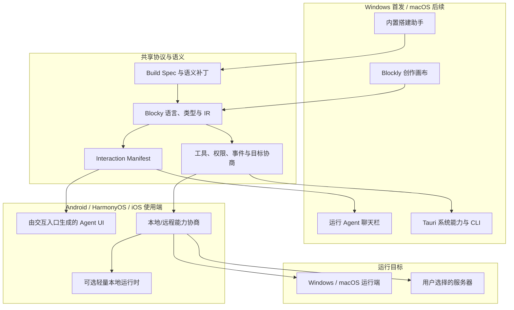

# ADR-001：Blocky 平台分层与桌面技术选型

| 项目 | 内容 |
|---|---|
| 状态 | 已接受；第一阶段 Windows Core（Windows 核心）技术尖峰已通过，第二、第三阶段未验证 |
| 日期 | 2026-08-09 |
| 修订 | v0.3，记录 2026-08-10 Windows Core 技术尖峰 L3 通过结论 |
| 决策范围 | Windows 首发；macOS 后续提供同等完整应用；Android、HarmonyOS、iOS 后续提供 Agent 使用端 |

## 1. 决策摘要

Blocky 采用“共享语言与运行协议、按设备职责分层”的产品架构：

- **Windows**：首发完整桌面应用，包含积木创作、搭建助手、运行 Agent、调试、CLI、官方 Skills 与本机适配器。
- **macOS**：后续提供与 Windows 同级的完整桌面应用，而不是只读或轻量移动版。
- **Android、HarmonyOS、iOS**：后续提供“使用搭建好 Agent”的应用，不提供积木工具箱、画布或完整 Agent 创作能力。
- **移动端执行位置不是固定的**：轻量、可移植且设备能力满足的 Agent 可以本地运行；依赖桌面终端、桌面文件、浏览器自动化、特定插件或原生运行时的 Agent 连接 Windows、macOS 或用户选择的服务器运行。
- **执行前必须协商能力**：应用根据 Agent 声明、设备能力、权限与用户选择，明确显示“本机运行”“远程运行”或“当前不可运行”，禁止静默把本地任务转交远端。
- **权益不分叉架构**：先完成同一套积木语言、工具协议与运行能力，再设计教育基础、教育拓展和专业版的可用范围。

首发不提供 Web 入口。桌面应用可以使用系统 WebView 加载安装包内资源，但不把 Blocky 作为网站部署。

## 2. 桌面技术选择

Windows 与后续 macOS 的完整应用采用：

- Tauri 2：原生应用壳、进程与系统能力边界。
- React + TypeScript：应用界面与状态编排。
- Blockly：积木编辑、连接、拖拽、缩放与工作区序列化。
- Rust/Tauri commands：安全存储、文件、子进程、系统集成和敏感能力代理。
- 纯 TypeScript 共享内核：Blocky 语言、类型、IR、Build Spec、Interaction Manifest、运行协议与迁移。

Blockly 只负责编辑体验。运行时不直接解释 Blockly 内部对象，而是执行版本化的 Blocky IR 或连接经过验证的原生 Agent 运行时。

## 3. 移动使用端

Android 与 iOS 优先复用 Tauri 2、React 和共享 TypeScript 包；HarmonyOS 使用 ArkTS/ArkUI 实现原生应用壳，并复用协议、Schema、测试向量和可移植运行逻辑。是否在 HarmonyOS 使用 ArkWeb 承载部分共享界面，由移动端技术尖峰决定，不把它设为产品前提。

移动端必须包含：

- 账号、设备与运行端配对。
- Agent 列表、版本和能力要求展示。
- 由 `InteractionManifest` 生成的输入入口和附件能力。
- 本地/远程执行目标选择与能力协商。
- 流式输出、工具进度、审批、取消、断线恢复和脱敏历史。
- 权限、隐私、网络与费用影响提示。

移动端明确不包含：积木工具箱、积木画布、自定义积木编辑器、原生兼容项目写回和完整调试器。

## 4. 共享架构



### 建议目录

```text
apps/
  desktop/                 # Windows 首发、macOS 后续的完整 Tauri 应用
  mobile-tauri/            # Android/iOS Agent 使用端
  harmony/                 # HarmonyOS Agent 使用端
packages/
  app-ui/                  # 桌面公共界面
  block-editor/            # Blockly 编辑器与积木外观
  block-language/          # 积木定义、类型、编译、IR 与迁移
  build-spec/              # Agent 可读写的声明格式和语义补丁
  interaction-manifest/    # 运行输入入口和界面能力投影
  runtime/                 # 可移植的确定性运行能力
  target-negotiation/      # Agent 要求与运行端能力匹配
  host-contracts/          # 工具、权限、流式事件和错误协议
  builder-agent/           # Blocky 内置搭建助手的最小运行框架
  cli/                     # 与桌面画布共用语义的 blocky CLI
integrations/
  agent-compat/            # Pi、Codex、OpenClaw、Hermes、OpenCode、DeepSeek Harness 适配器
  agent-skills/            # Blocky 官方 Skills
try/                       # 可删除技术尖峰
```

第一阶段 Windows Core 已取得 GO（继续）结论，现授权设计正式 monorepo（单体仓库）与共享包边界；这不等于授权把尖峰整体复制为产品，也不等于正式骨架、发行、收费或完整 311 块支持已经完成。目录和契约版本仍须在后续正式架构设计中重新评审后落地。

## 5. 项目与运行事实源

Blocky 项目同时保存：

1. `workspace.json`：积木位置、折叠、注释等编辑状态。
2. `program.json`：规范化、版本化的 Blocky IR。
3. `interaction-manifest.json`：由交互入口积木生成的运行界面契约。
4. 来源映射、资产、工具和自定义积木声明。

运行事件必须携带稳定节点 ID，使桌面画布、右侧聊天栏、CLI 与移动使用端看到同一个运行事实。项目不得保存密钥、Token、Cookie或未经可移植化的本机绝对路径。

## 6. 平台能力与目标协商

每个 Agent 发布物声明：

- 必需和可选能力。
- 工具、Skill、插件和原生运行时依赖。
- 文件、网络、终端、浏览器、麦克风等权限。
- 支持的输入入口及其图片、文件、语音等能力。
- 是否允许本地、远程或两者运行。
- 资源预算和最低协议版本。

每个运行端报告能力清单与协议版本。协商结果只有三种：

- `LOCAL_READY`：本机满足所有必需能力。
- `REMOTE_REQUIRED`：本机不满足，但已选择且已配对的运行端满足。
- `UNAVAILABLE`：没有满足要求且得到用户授权的运行端。

缺少可选能力时可以降级，但必须显示具体影响。缺少必需能力时不得以“可能可以”的方式启动。

## 7. 安全边界

- WebView 不持有长期模型密钥，也不直接取得任意系统权限。
- 文件、终端、网络、浏览器、插件和外部副作用都通过版本化 Host 契约。
- 权限由 Agent 声明、运行端能力和用户授权三者共同决定；连接远端不能扩大原 Agent 权限。
- 远程运行需显式配对、身份校验、加密传输和可撤销凭据。
- 运行目标切换、敏感数据上传和可能产生费用的远程执行必须可见。
- 本地与远程日志默认脱敏，项目导出不得包含安全存储中的真实凭据。

## 8. 技术尖峰顺序

### 第一阶段：Windows Core 尖峰

状态：**已通过**。最终 L3 验收对象为测试提交 `7eeb9a8e0974b4356e24abf80c3ade46d486af6e`，独立复审为 Critical（严重）0 / Important（重要）0 / Minor（次要）0。详细架构、性能、360-cycle（循环）/30 分钟长稳、安全与人工证据见 [Windows Core 技术尖峰报告](./Windows-Core技术尖峰报告.md) 和[任务验收记录](../验收/归档/2026-08-10/验收-Windows-Core技术尖峰.md)。

1. 从安装包本地加载 Blockly，不依赖远程站点。
2. 创建、连接、折叠、缩放并保存不少于 100 个积木。
3. 工作区编译为稳定 IR，并把运行事件映射回画布。
4. 双标签右栏正常切换；无交互入口时运行标签禁用。
5. 交互入口增删能力后，右侧输入栏按 `InteractionManifest` 同步更新。
6. Tool 容器的引用调用和显式调用共享同一工具契约。
7. 模拟模型支持流式输出、取消、错误和权限请求。
8. 项目与日志敏感信息扫描为零。

### 第二阶段：Windows 完整能力

在 Core 通过后，验证 CLI 往返、搭建助手的审阅/直接搭建模式、自定义积木、插件隔离和四类原生 Agent 适配器。

状态：**未验证**。第一阶段 GO 只允许开始正式仓库与共享包设计，不把本阶段自动标记为已实现。

### 第三阶段：后续平台

- macOS：完成与 Windows 同级的创作、CLI、适配器和签名验收。
- Android/iOS/HarmonyOS：先验证 `InteractionManifest` 生成界面、目标协商、轻量本地运行、配对与断线恢复，再决定各平台具体 UI 壳实现。

状态：**未验证**。现有移动工具链准备与 Windows Core 结论都不能替代各平台独立尖峰、真机、签名和发布验收。

Windows Core 失败时先修正桌面架构，不能用未验证的移动端工作掩盖核心风险。

## 9. 测试基线

- 语言层：类型、连接、编译、迁移、未知积木保留和确定性 IR。
- 交互层：零/单/多入口、重命名、功能解锁、输入路由和旧项目迁移。
- 工具层：引用与显式调用、Schema、流式结果、取消、超时和权限拒绝。
- 搭建助手：语义补丁预览、应用、逐轮检查点、撤销和高风险确认。
- 平台桥：请求、响应、流式事件、取消与统一错误码契约测试。
- 目标协商：本地满足、远程满足、可选降级、必需缺失和断线。
- 设备验收：每个平台真机验证输入、附件、权限、后台和安全存储；模拟器不能替代最终设备验收。

## 10. 未选择的方案

| 方案 | 结论 | 原因 |
|---|---|---|
| Windows、Android、HarmonyOS 同时提供完整积木编辑 | 放弃 | 移动画布显著增加交互、性能和兼容成本，也不符合已确认的产品职责 |
| Web 版编辑器 | 不采用 | 产品明确为可安装应用，且系统工具与本地协作是核心能力 |
| 全原生重写积木编辑器 | 不采用 | 重复实现连接、拖拽、缩放、序列化和可访问性，首版风险过高 |
| Flutter 作为所有平台共同编辑器 | 不采用 | Blockly 仍需嵌入 WebView，HarmonyOS 也不是 Flutter 官方主线平台 |
| 手机永远只做远程终端 | 不采用 | 会错误限制可移植轻量 Agent 的本地能力 |
| 手机自动选择并静默转发到远端 | 禁止 | 数据位置、权限、延迟与费用必须由用户知情 |

## 11. 官方依据

- Tauri 2 支持 Windows、macOS、Android 与 iOS，并使用系统 WebView：<https://v2.tauri.app/start/>
- Tauri 各目标平台的签名与分发要求：<https://v2.tauri.app/distribute/>
- Blockly 推荐使用 JSON 序列化，并允许自定义序列化器：<https://developers.google.com/blockly/guides/configure/web/serialization>
- Blockly 连接检查支持自定义类型约束：<https://developers.google.com/blockly/guides/create-custom-blocks/inputs/connection-checks>
- HarmonyOS 官方开发入口：<https://developer.huawei.com/consumer/cn/develop/>

HarmonyOS 的具体 SDK、ArkUI/ArkWeb 能力与商店要求具有时效性，进入该平台实现前必须重新核验官方文档；本 ADR 不把当前未完成的页面核验当作已验证工程结论。
