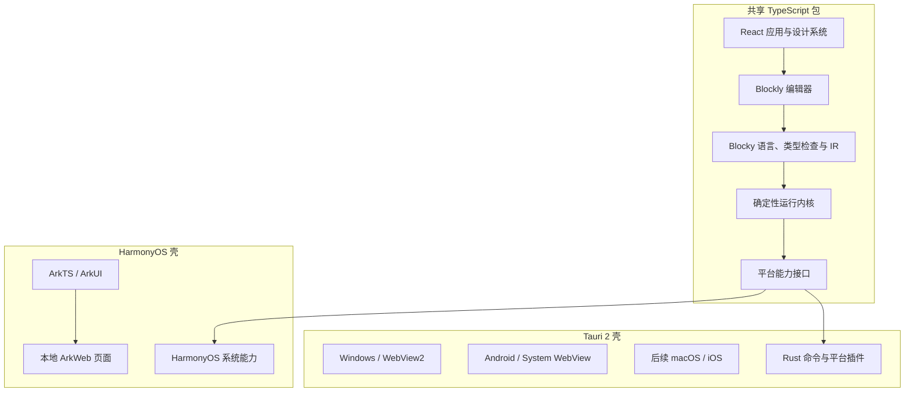

# ADR-001：Blocky 首版跨端技术选型

| 项目 | 内容 |
|---|---|
| 状态 | 已接受，须通过技术尖峰后锁定 |
| 日期 | 2026-08-09 |
| 决策范围 | Windows、Android、HarmonyOS 首版；兼顾 macOS、iOS 后续适配 |

## 1. 背景与约束

Blocky 的核心界面不是普通表单，而是支持大量 SVG 积木、嵌套、吸附、缩放、触控和实时执行高亮的视觉语言编辑器。首版还必须满足：

- 无 Web 版，但允许在安装包内部使用 WebView 渲染本地资源。
- Windows、Android、HarmonyOS 尽量共享编辑器、视觉语言和运行语义。
- macOS、iOS 后续加入时不推翻架构。
- 项目和教程本地可用；模型密钥不能落入 WebView 存储或项目文件。
- 教育版与专业版不能形成两套不兼容代码。
- HarmonyOS 不能建立在 Google Flutter 官方支持的假设上。

## 2. 决策摘要

采用混合原生架构：

- **积木编辑器与应用界面**：React + TypeScript + Blockly，构建为只从安装包加载的本地静态资源。
- **Windows、Android，后续 macOS/iOS**：Tauri 2 原生壳。
- **HarmonyOS**：ArkTS + ArkUI 原生壳，通过 ArkWeb/Web 组件加载同一份本地前端资源。
- **视觉语言与运行内核**：纯 TypeScript 包，独立于 React、Tauri 和 ArkTS；由平台能力接口访问模型、文件、安全存储和系统功能。
- **Blockly 只负责编辑体验**：保存 Blockly 工作区，同时编译为独立、版本化的 Blocky IR；运行时不直接解释 Blockly 内部对象。
- **首版不建设远程后端**：本地项目、模拟模型和用户自备 OpenAI 兼容接口先完成闭环。
- **高级原生 Agent 走独立兼容层**：OpenClaw 与 Hermes 不编译进 Blocky 运行内核，由 ADR-002 定义的进程外适配器托管或连接官方运行时。

这不是 Web 版：应用不提供浏览器入口、不部署前端站点，HTML/JS/CSS 只作为安装包内的 UI 资源运行。

## 3. 架构



### 建议的未来目录

```text
apps/
  tauri/                 # Windows、Android，后续 macOS/iOS
  harmony/               # ArkTS/ArkUI 壳与 HarmonyOS 适配器
packages/
  app-ui/                # React 应用外壳与响应式布局
  block-editor/          # Blockly 注入、主题、工具箱与交互
  block-language/        # 积木定义、类型系统、编译器、IR、迁移
  build-spec/            # 面向 CLI/Agent 的声明式交换格式与往返映射
  cli/                   # blocky 命令行入口，复用语言、运行时和契约包
  runtime/               # 确定性解释器与执行事件
  host-contracts/        # 平台能力接口、消息协议和 Schema
  design-system/         # 教育/专业共享组件与设计令牌
  test-fixtures/         # 跨平台样例与兼容性文件
integrations/
  agent-skills/          # Blocky 官方 Agent Skills 源文件与发布清单
doc/
try/                     # 一次性技术尖峰和实验产物
```

本 ADR 不创建代码骨架；目录在技术尖峰通过后生成，避免在关键兼容性未验证前制造无效脚手架。

## 4. 为什么选择这套方案

### Blockly 与 WebView 是核心事实

Blockly 已提供积木渲染、嵌套连接、类型检查、拖拽和 JSON 序列化。Blocky 的差异应投入在 Agent 视觉语言、执行可观察性和社区格式，而不是从零重写拖拽引擎。

Tauri 直接以系统 WebView 承载前端，并支持 Windows、macOS、Android 和 iOS；因此在 Windows 与 Android 上不需要再给 Blockly 包一层 Flutter 组件。HarmonyOS 虽不在 Tauri 支持平台中，但 ArkTS 与 ArkWeb 可以作为薄壳复用本地前端资源。

### 对比方案

| 方案 | 优点 | 关键问题 | 结论 |
|---|---|---|---|
| Tauri 2 + React/Blockly + HarmonyOS 薄壳 | 最贴合 Blockly；桌面与 Android 共享度高；包体和原生桥清晰 | HarmonyOS 壳需单独维护；必须验证 ArkWeb 触控和消息桥 | 选择 |
| Flutter + Blockly WebView | 常规界面跨端一致；官方支持 Windows/Android/iOS/macOS | Blockly 仍在 WebView；Flutter 官方不直接支持 HarmonyOS，需依赖社区分支；桌面 WebView 又增加插件层 | 不选作首版主线 |
| Electron + 原生移动端 | 桌面生态成熟，Blockly 集成简单 | 包体与内存较重；Android/HarmonyOS 需要另一套壳 | 放弃 |
| 全原生 WinUI/Kotlin/ArkUI | 平台能力最直接 | 三套 UI 与积木编辑器，成本和语义漂移不可接受 | 放弃 |
| 自研 Canvas 积木引擎 | 彻底控制体验 | 首版风险极高，重复解决拖拽、连接、可访问性和序列化 | 仅在 Blockly 被验证无法满足时重评 |

Flutter 官方当前列出的支持平台包含 Android、iOS、Windows 和 macOS，但不包含 HarmonyOS；Flutter 项目对直接支持 HarmonyOS 的公开答复也是“不计划”，OpenHarmony 兼容由社区分支提供。因此，首版不能把 Flutter 当作真正的一套代码覆盖全部目标平台。

## 5. 语言、项目与运行模型

### 两层数据，不混为一谈

1. **Workspace State**：Blockly JSON，保存位置、折叠、注释和编辑器状态。
2. **Blocky IR**：规范化语义程序，包含节点、类型、控制结构、权限、来源映射和 Schema 版本。

保存时先校验工作区，再编译 IR。运行时只执行 IR；每个 IR 节点保留对应积木 ID，以便将运行事件映射回画布。

### `.blocky` 项目容器

首版定义一个 ZIP 容器，扩展名为 `.blocky`：

```text
manifest.json             # 项目 ID、名称、schemaVersion、最低权益、权限声明
workspace.json            # Blockly 工作区状态
program.json              # 规范化 Blocky IR
assets/                   # 教程或作品本地资源
```

要求：

- 不保存密钥、Token、Cookie、模型凭据和本机绝对路径。
- 读取未知字段和未知积木时尽量保留原数据，避免旧版或教育版破坏作品。
- 每次格式变更提供单向迁移和测试样例，不允许运行时猜测版本。
- 导入 ZIP 时校验文件数量、大小和路径，防止路径穿越与压缩炸弹。

### 运行内核

运行内核采用可暂停的异步解释器，而不是直接生成 JavaScript 并执行。它输出版本化事件：

```text
run.started
block.started
block.output.preview
permission.requested
run.suspended
block.failed
run.completed
```

这样教育动画、专业日志、人工确认和错误定位共享同一个事实源。循环必须有静态上限和运行预算；模型调用、文件访问和外部行动都通过平台能力接口，禁止积木直接调用系统 API。

## 6. 平台能力边界

`host-contracts` 使用 JSON Schema 描述请求、响应和流式事件，所有消息包含协议版本、请求 ID、能力 ID 和取消信号。

首版能力接口：

- `project.open/save/export/import`
- `secret.set/get/delete`
- `model.list/test/stream`
- `runLog.append/export`
- `system.openExternal`（仅白名单 URL）

### 模型调用

- WebView 不直接持有 API Key，也不直接跨域请求模型。
- 前端向原生壳提交经过 Schema 校验的模型请求；原生壳从系统安全存储读取凭据并发起 HTTPS。
- 默认提供完全离线、确定性的模拟模型供教程与自动测试使用。
- 首个真实适配器采用可配置的 OpenAI 兼容协议，但不在文档或示例中写入真实地址和密钥。

### 本地数据

- `.blocky` 文件是可移植作品的事实来源。
- 最近项目、设置和运行索引通过存储接口维护；Tauri 端可使用 SQLite，HarmonyOS 端使用 ArkData/关系型存储。
- Windows 使用系统凭据/安全存储能力；Android 使用 Keystore；HarmonyOS 使用 Asset Store Kit 或通用密钥库；后续 macOS/iOS 使用 Keychain。

## 7. 教育版、专业版与积木包

版本权益不进入运行语义。每个积木定义可声明 `core`、`education`、`professional` 或特定积木包权益；编译器遇到无权益积木时返回 `ENTITLEMENT_REQUIRED`，但编辑器和保存器必须保留其全部内容。

MVP 积木定义由仓库随应用发布。公开社区上线前，积木包只允许：

- 声明式积木定义、Schema、本地化文案、图标和受控能力 ID。
- 经过签名、版本约束、权限审查和兼容性检查后安装。
- 不允许附带任意 JavaScript、ArkTS、Rust 或原生二进制代码。

如未来确需第三方计算逻辑，另立 ADR 评估 WASM 沙箱、资源配额、签名撤销和审核流程，不能直接放宽现有包格式。

OpenClaw 与 Hermes 的内置兼容模板不是社区积木包的安全例外。它们是 Blocky 随产品维护、版本固定、进程隔离并单独验收的系统级适配器；第三方积木包仍不得携带任意原生代码。详见 [ADR-002](ADR-002-原生Agent兼容运行时.md)。

## 8. 平台基线

- Windows：Windows 10/11，x64 首发；WebView2 缺失时由安装器显式引导安装。
- Android：Android 10（API 29）及以上作为 Blocky MVP 基线。Tauri 本身可支持更低版本，但首版主动减少旧 WebView、触控与安全差异。
- HarmonyOS：兼容 HarmonyOS 5（API 12）及以上；使用实现时的最新稳定 SDK 编译并在仓库锁定，不使用 Beta API 作为核心依赖。
- macOS/iOS：本期只保留接口兼容性，不产出或声称验证构建；正式构建需要 macOS 与 Xcode 环境。

HarmonyOS 7（API 26）已在 2026 年发布，但 Blocky 首版不依赖 API 26 专属能力，以免无必要缩小可安装设备范围。

## 9. 技术尖峰与淘汰门槛

在正式搭建业务代码前，先在 `try/` 完成可删除的三端尖峰。必须同时验证：

1. 同一 Blockly 页面从安装包本地加载，不依赖远程站点。
2. Windows、Android、HarmonyOS 均能拖拽、嵌套、缩放并保存 100 个积木。
3. 触控拖拽、长按、双指缩放、软键盘输入和返回键行为可用。
4. 同一 `workspace.json` 在三端往返，规范化 IR 一致。
5. 原生壳能完成模拟流式模型响应、取消和错误回传。
6. 密钥只进入平台安全存储，导出项目和日志扫描结果为零。
7. 连续编辑与运行 30 分钟无崩溃、无项目损坏、无明显持续内存增长。

若 HarmonyOS ArkWeb 在积木触控、SVG 性能或本地桥接上无法通过第 2—5 项，暂停业务开发并重新评估 Flutter-OH 或自定义渲染；不得在失败架构上继续堆功能。

## 10. 测试策略

- 语言层：积木类型、编译、迁移、循环上限和权限的单元/属性测试。
- 运行层：使用模拟模型覆盖成功、拒绝确认、取消、超时、重试和失败分支。
- 格式层：跨版本 golden files、未知积木保留、恶意 ZIP 导入测试。
- 编辑器：拖拽、撤销/重做、键盘导航、触控和序列化测试。
- 平台桥：契约测试保证 Tauri 与 HarmonyOS 返回同一错误码和事件顺序。
- 设备验收：Windows 真机、至少一台 Android 真机和一台 HarmonyOS 真机完成相同任务；模拟器或预览器不能替代触控与安全存储验收。

## 11. 依赖原则

- 使用 `pnpm workspace` 管理 TypeScript 包，提交锁文件并固定实现时的稳定版本。
- Tauri、Rust、Node.js、Blockly 等版本在技术尖峰通过后写入工具链文件；本 ADR 不凭文档日期预先锁死版本号。
- 不在 MVP 引入 LangChain、复杂 Agent 框架、远程队列、向量数据库或微服务。
- 缺失依赖必须安装到项目环境或明确报告，不能跳过对应平台验证。

OpenClaw 与 Hermes 的运行依赖、版本锁定和升级节奏不进入首个 MVP 依赖图；待基础运行内核稳定后，按各自兼容矩阵独立安装和测试。

`blocky` CLI 采用 TypeScript 实现并直接复用 `block-language`、`build-spec`、`runtime` 与 `host-contracts`。开发阶段作为 workspace 包运行；正式 Windows 安装包提供可从任意目录调用的命令入口和随应用分发的运行环境，不要求普通用户自行全局安装 Node.js。具体接口与打包验证见 [ADR-003](ADR-003-CLI与官方Agent-Skill接口.md)。

## 12. 官方依据

- Tauri 2 官方说明其同一代码库支持 Linux、macOS、Windows、Android、iOS，并以系统 WebView 承载前端：<https://v2.tauri.app/>
- Tauri 官方 Android 发布文档说明最低可支持 Android 7/API 24；Blocky 主动选择 API 29 是产品基线，而非框架限制：<https://v2.tauri.app/distribute/google-play/>
- Blockly 官方推荐新项目使用 JSON 序列化，并支持自定义序列化器：<https://developers.google.com/blockly/guides/configure/web/serialization>
- Blockly 连接检查可约束类型与非法拼接：<https://developers.google.com/blockly/guides/create-custom-blocks/inputs/connection_checker>
- Flutter 官方支持列表包含 Android、iOS、Windows、macOS，但没有 HarmonyOS：<https://docs.flutter.dev/reference/supported-platforms>
- Flutter 官方仓库关于 HarmonyOS 的议题说明没有直接支持计划，OpenHarmony 支持来自社区适配：<https://github.com/flutter/flutter/issues/150536>
- HarmonyOS 官方以 ArkTS/ArkUI 为应用主开发栈：<https://developer.huawei.com/consumer/cn/develop/index.html>
- HarmonyOS 官方文档确认 2026 年已发布 HarmonyOS 7/API 26：<https://developer.huawei.com/consumer/cn/information/releases>
- HarmonyOS Asset Store Kit 用于短敏感数据的安全存储：<https://developer.huawei.com/consumer/cn/doc/harmonyos-guides-V14/asset-store-kit-overview-V14>
