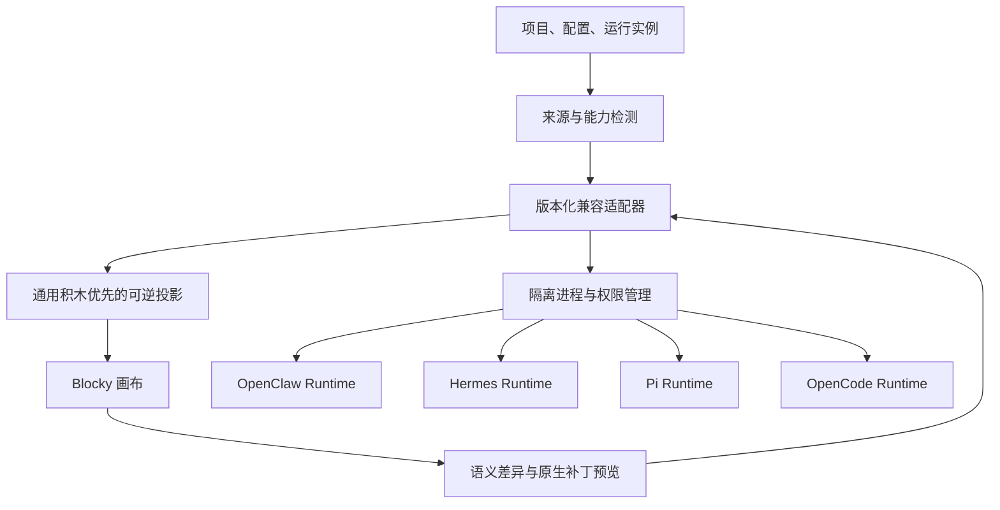

# ADR-002：官方 Agent 兼容运行时

| 项目 | 内容 |
|---|---|
| 状态 | 已接受，须按上游和平台分别通过兼容尖峰 |
| 日期 | 2026-08-09 |
| 修订 | v0.2，将 Pi 与 OpenCode 纳入官方模板和兼容体系 |
| 决策范围 | OpenClaw、Hermes、Pi、OpenCode 官方积木模板与原生运行时适配 |
| 关联文档 | [四类内置兼容模板](../产品设计/内置兼容模板-OpenClaw-Hermes-Pi与OpenCode.md)、[ADR-001](ADR-001-首版跨端技术选型.md) |

## 1. 背景

Blocky 要让用户通过积木理解、搭建并改造主流 Agent，同时尽可能保持原项目能力。OpenClaw、Hermes、Pi 与 OpenCode 都有自己的运行循环、工具、配置、会话和扩展边界；把它们重新实现为一套“看起来相似”的 Blocky 运行逻辑会产生不可验证的行为漂移。

这些模板的目标不是为每个项目增加一组不可复用的专属积木，而是：

- 用 Agent、模型、提示词/上下文、Tool、记忆/知识、Skill/插件、子 Agent、权限和交互入口等通用积木表达大部分结构。
- 对无法无损抽象的原生语义，以命名空间积木或受控原生保留区呈现。
- 修改后仍可生成最小差异并由上游原生运行时执行。
- 把逆向经验沉淀为官方 `现有 Agent 逆向积木` Skill，而不是把临时映射写死在 UI。

## 2. 决策

四个官方模板统一采用：

> 固定并验证上游版本 + 进程外原生运行时 + 版本化适配器 + 可逆积木投影

具体规则：

- Blocky 不把四个上游运行时重写进确定性运行内核。
- 每个模板记录上游项目、版本/提交、来源、内容校验和、许可证和兼容等级。
- 适配器读取能力、配置、项目文件与事件，投影为通用积木优先的 Blocky 项目。
- 写回先生成语义差异预览，再使用格式感知的最小补丁；未知字段和注释不得静默丢失。
- 上游运行时与 Blocky 主进程隔离，由 Supervisor 管理启动、健康、日志、权限和回退。
- Windows 首发提供完整投影、编辑、写回与运行；macOS 后续达到同等能力。
- Android、HarmonyOS、iOS 仅作为 Agent 使用端。若上游没有经过验证的本地移动运行方式，则连接桌面或用户服务器，不伪装成本机执行。
- `blocky compat` CLI、桌面画布、搭建助手和官方 Skills 必须调用同一适配器协议，禁止形成旁路。



## 3. 通用兼容协议

`host-contracts` 提供版本化 `agent-compat` 协议，至少包括：

```text
runtime.detect
runtime.install.plan
runtime.install.apply
runtime.start
runtime.stop
runtime.health
capabilities.describe
config.read
config.validate
config.patch.preview
config.patch.apply
project.import
project.export
projection.read
projection.diff
run.start
run.interrupt
run.approval.respond
events.subscribe
compatibility.report
```

所有响应包含适配器协议版本、上游标识、上游版本、运行实例 ID、能力摘要和结构化错误来源。事件同时保留标准化类型和上游原生类型，便于统一显示且不丢失专属语义。

统一协议只统一生命周期、工具契约、权限与可观察性，不强迫四个上游拥有相同配置或行为。

## 4. 可逆投影

兼容项目以原生内容为事实源，在 Blocky 项目中保存引用、映射和不透明保留数据：

```text
compat/origin.json
compat/mapping.json
compat/native/
compat/opaque.json
compat/diff-base.json
```

投影顺序：

1. 检测上游版本、配置 Schema、目录和运行能力。
2. 解析结构并为每个来源节点分配稳定 `originRef`。
3. 优先映射到通用语义积木；只在确有独立运行含义时使用上游命名空间积木。
4. 无法安全解释的字段保存在 `opaque.json`，并以原生查看/受控编辑形式暴露。
5. 用户修改后生成 Blocky 语义差异和原生补丁预览。
6. 应用前重读上游状态并检测并发变化；冲突不得自动覆盖。
7. 应用后调用上游校验、重读并进行语义比较；失败则回滚本次写入。

模板经用户增删积木后是“基于某上游模板构建的 Blocky Agent”。只有继续通过对应上游兼容矩阵时，才能标注“兼容该上游”；不得自动宣称与原版功能一致。

## 5. OpenClaw 模板

OpenClaw 模板重点表达长驻 Gateway、渠道、节点、定时任务、工具、Skills 和配置 Schema：

- 优先通过官方 Gateway 协议与实时配置 Schema 做能力发现和运行控制。
- Gateway、渠道和节点的独立语义可以使用 `openclaw.*` 命名空间积木。
- 连接既有实例默认只读；写配置、安装扩展、启用工具或执行设备动作需要对应授权。
- 未识别的 Schema 字段进入原生保留区，不能因为 Blocky 尚无控件而被删除。

## 6. Hermes 模板

Hermes 模板重点表达会话、流式工具进度、审批、澄清、secret/sudo、多 Agent、分支、Skill、Plugin、MCP、Hook 与 Memory：

- 优先使用上游稳定公开的 RPC/API 能力，而不是直接修改其会话数据库。
- 工具进度、审批和澄清映射为通用工具/权限/交互事件，同时保存原生事件类型。
- 会话截断、sudo 和 secret 请求属于敏感操作，要求不可复用的当次确认。
- 配置中的凭据只映射为安全存储引用和“已配置/未配置”状态。

## 7. Pi 模板

Pi 模板刻意保持极简，用来证明少量高复用积木可以组成实用编码 Agent：

- 默认结构仅包含一个聊天交互入口、一个 Agent、一个模型，以及 `read`、`write`、`edit`、`bash` 四个默认工具。
- Extensions、Skills 和 Packages 作为可选扩展，不为 Pi 创建重复的模型、工具或 Agent 专属积木。
- JSON、RPC 和 SDK 等嵌入方式通过适配器或 Host 契约接入；界面仍显示同一套运行事件。
- 若用户加入复杂记忆、多 Agent 或新工具，项目可以超出 Pi 默认模板，但必须重新评估是否仍能由固定版本 Pi 原生运行。

原 `badlogic/pi-mono` 官方入口现已指向 `earendil-works/pi`；实现和版本固定时以重定向后的现行上游为准，不能长期依赖旧仓库名。

## 8. OpenCode 模板

OpenCode 模板覆盖比 Pi 更完整的编码 Agent 编排：

- 主 Agent、子 Agent 与不同 Agent 配置。
- 模型、提示词、上下文和会话控制。
- 工具及其权限策略、MCP、自定义工具。
- Skills、Plugins、Commands 等扩展入口。
- 文件、终端和其他 Host 能力的审批与事件显示。

上述能力优先使用通用 Agent、Tool、Skill/插件、多 Agent 和权限积木。只有上游特有配置或生命周期无法由通用语义无损表达时，才增加 `opencode.*` 原生保留积木。

## 9. “逆向 Agent 积木”Skill 的复用方法

官方 Skill 不通过项目名称套用固定模板，而执行可验证的分析流程：

1. 识别入口、配置、Agent 循环、模型、消息、工具注册、上下文、记忆、扩展、权限和交互界面。
2. 建立“源码/配置来源 → 通用语义 → 积木 ID”的证据表。
3. 先复用官方原子积木和可展开组合积木，再使用可视化自定义积木。
4. 只对局部不可约逻辑使用带类型、权限和沙箱声明的代码自定义积木。
5. 无法安全解释的原生内容进入保留区，不能凭猜测重写。
6. 生成能力覆盖、未映射内容、权限、运行目标和可逆性报告。
7. 用原生入口与 Blocky 入口运行同一 fixture，比较事件序列、结果与副作用计划。

若每逆向一个 Agent 都要新增大量专属积木，视为通用积木抽象或表达能力存在缺口，应先改进核心语言而非继续堆专属积木。

## 10. 进程、版本与升级

- 托管运行时安装到应用数据区的独立版本目录，不写入项目仓库，也不要求全局安装。
- 只从记录在兼容清单中的上游来源获取；下载、安装和更新均先生成计划。
- 默认运行最后一个通过相应兼容矩阵的固定版本，不自动切换到未知新版本。
- 新版本与旧版本并存验证；通过后才切换，失败可以恢复旧运行时和原生数据。
- 连接用户已有实例时只报告版本和兼容等级，不擅自升级。
- 具体上游版本必须在实现时联网重验并写入锁定清单；本 ADR 不把设计日看到的版本号当作长期事实。

## 11. 安全与许可证

- Blocky 主应用、适配器和上游运行时使用独立进程与最小文件范围。
- 原生命令、脚本、Tool、Plugin、Skill 和 MCP 不自动继承 Blocky 主进程权限。
- 凭据保存在平台安全存储或上游受支持的安全位置，项目只保存引用。
- 外部消息、删除、支付、发布、会话破坏、sudo 与设备动作采用当次确认。
- 日志和导出默认脱敏，扫描 Token、Cookie、授权头、私钥与本机私有路径。
- 每个固定版本保存其许可证、版权、依赖材料和修改说明；不得以模板名称暗示上游合作或认证。
- 许可证与商标结论在每次分发前重新审查，本 ADR 不替代法律审核。

## 12. 平台拓扑

### Windows 与 macOS

- 完整积木投影、编辑、差异预览、写回、运行和调试。
- 可连接已有实例，也可托管经过验证的固定版本运行时。
- Supervisor 管理端口、子进程、资源、日志、崩溃恢复与版本回退。

### Android、HarmonyOS 与 iOS

- 显示由交互入口积木生成的 Agent 输入与运行界面。
- 若“Agent 要求 × 设备能力 × 上游支持”全部满足，可以启用经过单独验收的本地运行。
- 其他情况连接用户已配对的桌面或服务器运行端，并明确显示远程数据和执行位置。
- 不提供原生配置投影、积木编辑和写回。

## 13. 验证矩阵

每个“上游版本 × 桌面平台 × 运行模式”单独验收：

- 来源：版本、提交、校验和、许可证和官方发布对应。
- 格式：官方样例、未知字段、注释、顺序和并发修改往返。
- 契约：能力发现、配置校验、运行、取消、审批、断线和错误。
- 行为：相同 fixture 走上游原生入口与 Blocky，比较事件序列、最终状态和副作用计划。
- 扩展：Tool、Skill、Plugin、MCP、Hook 或上游等价能力的发现和隔离。
- 安全：目录越界、未授权远程访问、恶意配置、日志泄漏和权限扩大。
- 升级：旧项目、新字段、失败回退和并发冲突。

移动使用端另验收交互清单、能力协商、配对、远程标识、断线恢复与取消，不因桌面兼容通过而自动通过。

## 14. 实施顺序

1. 先通过 Windows Blocky Core 与通用 Tool/交互入口协议尖峰。
2. 定义 `agent-compat` 协议及假数据适配器桩。
3. 以 Pi 验证最小通用映射，以 OpenCode 验证较丰富的编码 Agent 映射。
4. 分别实现 OpenClaw、Hermes 的只读扫描与运行连接。
5. 四套适配器先完成投影和行为对照，再逐个开放写回和托管安装。
6. 把映射证据、覆盖报告和失败模式固化进“逆向 Agent 积木”Skill。
7. Windows 稳定后再验收 macOS完整能力和移动使用端。

## 15. 官方依据

- OpenClaw 官方仓库：<https://github.com/openclaw/openclaw>
- OpenClaw 架构：<https://docs.openclaw.ai/concepts/architecture>
- Hermes 官方仓库：<https://github.com/NousResearch/hermes-agent>
- Hermes 开发架构：<https://hermes-agent.nousresearch.com/docs/developer-guide/architecture>
- Pi 官方仓库：<https://github.com/earendil-works/pi>
- Pi coding agent（默认工具、扩展、Skills、Packages）：<https://github.com/earendil-works/pi/blob/main/packages/coding-agent/README.md>
- Pi Extensions：<https://github.com/earendil-works/pi/blob/main/packages/coding-agent/docs/extensions.md>
- Pi RPC：<https://github.com/earendil-works/pi/blob/main/packages/coding-agent/docs/rpc.md>
- OpenCode 官方仓库：<https://github.com/anomalyco/opencode>
- OpenCode Agents：<https://opencode.ai/docs/agents/>
- OpenCode Tools：<https://opencode.ai/docs/tools/>
- OpenCode Skills：<https://opencode.ai/docs/skills/>
- OpenCode Plugins：<https://opencode.ai/docs/plugins/>
