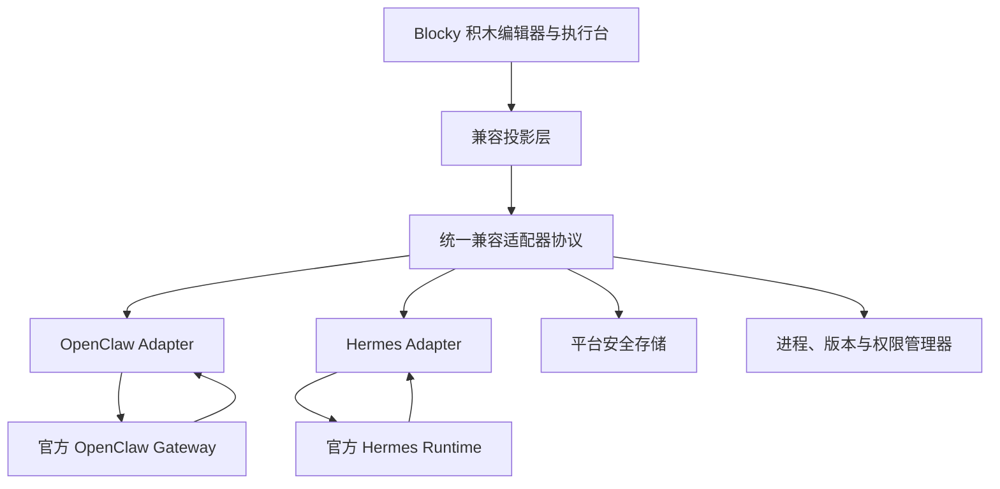

# ADR-002：OpenClaw 与 Hermes 原生 Agent 兼容运行时

| 项目 | 内容 |
|---|---|
| 状态 | 已接受，须通过分阶段兼容尖峰后实施 |
| 日期 | 2026-08-09 |
| 决策范围 | OpenClaw、Hermes 内置积木模板；Windows、Android、HarmonyOS |
| 关联文档 | [产品设计](../产品设计/内置兼容模板-OpenClaw与Hermes.md)、[ADR-001](ADR-001-首版跨端技术选型.md) |

## 1. 背景

Blocky 需要把 OpenClaw 和 Hermes 的完整原生能力以积木形式展现，并保持原项目行为。两者都有独立运行内核、配置、扩展、工具、会话、消息网关和快速演进的版本面；若将其逻辑重新实现为 Blocky IR，不仅工作量巨大，也会立即产生行为漂移，无法兑现“百分百继承”。

社区可执行扩展现按 [ADR-004](ADR-004-开放扩展与社区安全边界.md) 分型、签名、扫描并隔离运行。原生 Agent 兼容模板仍是单独验收的系统适配器，不能借社区扩展放宽其版本、权限和行为边界。

## 2. 决策

采用“进程外官方运行时 + Blocky 兼容适配器 + 可逆积木投影”架构：

- 不将 OpenClaw 或 Hermes 重写、转译或编译进 Blocky 确定性运行内核。
- Windows 可以连接已有原版实例，也可以由 Blocky 托管经过验证并固定版本的官方运行时。
- Android、HarmonyOS 作为编辑与控制客户端，通过安全连接访问 Windows 或用户服务器上的运行时。
- 每个适配器读取上游版本、能力描述、配置 Schema/原生文件和运行事件，生成带来源映射的 Blocky 积木。
- 写回采用格式感知的最小补丁；未知字段进入不透明保留区，不能被丢弃。
- 两套适配器分别维护版本兼容矩阵、golden fixtures、契约测试与许可证材料。
- ADR-003 定义的 `blocky compat` CLI 只调用同一适配器协议，不另建直接读写上游文件的旁路。



## 3. 未选择的方案

| 方案 | 不选择原因 |
|---|---|
| 用 Blocky IR 重写两套运行时 | 无法持续覆盖上游行为、插件和新字段，兼容承诺不可验证 |
| 只导入配置并由 Blocky 内核运行 | 看似可视化，实际改变工具、记忆、会话和错误语义 |
| 把上游代码直接链接进主进程 | 崩溃与权限边界耦合，依赖冲突和升级回退风险高 |
| 手机端分别移植完整运行时 | 与首版成本和平台现实不符；HarmonyOS 尤其缺少已确认的官方原生路径 |
| 用一套静态积木清单适配所有版本 | 上游快速变化后会静默漏能力，无法保留未知字段 |

## 4. 兼容适配器协议

`host-contracts` 后续增加版本化的 `agent-compat` 协议。最小接口：

```text
runtime.detect
runtime.install
runtime.start
runtime.stop
runtime.health
capabilities.describe
config.read
config.validate
config.patch.preview
config.patch.apply
project.import
project.export
run.start
run.interrupt
run.approval.respond
events.subscribe
compatibility.report
```

每个响应包含：适配器协议版本、上游项目、上游版本、运行实例 ID、能力版本和错误来源。运行事件携带原生事件类型、标准化事件类型、积木 ID、会话 ID 与可脱敏摘要。

“统一协议”只统一生命周期和展示所需字段，不抹平上游差异。OpenClaw 专属 Gateway/Node 语义和 Hermes 专属审批、澄清、sudo、secret、分支语义保存在命名空间字段和专属积木中。

## 5. OpenClaw 适配

OpenClaw 以长驻 Gateway 为控制平面，客户端和节点通过 WebSocket 连接。适配器应优先使用官方 Gateway 协议与实时配置 Schema：

- 通过握手读取实例、协议与能力信息。
- 使用 Gateway 请求、响应和事件流驱动会话、工具、聊天、节点和 Cron 的运行显示。
- 使用实时 Schema 生成配置积木和参数控件；静态积木定义只保存人类友好表达与已验证映射。
- 不认识的 Schema 字段生成 `openclaw.native.*` 透传积木。
- 连接已有 Gateway 时默认只读；写配置、安装 Skill/Plugin、启用工具或执行设备动作需要对应能力授权。

托管运行时独立于 Blocky 主进程。Supervisor 记录安装来源、版本、内容校验和、数据目录、端口、启动参数和最近一次健康状态。

## 6. Hermes 适配

Hermes 对外提供 ACP、TUI Gateway JSON-RPC 和 HTTP/SSE API。Blocky 完整桌面控制优先使用 TUI Gateway JSON-RPC：它覆盖会话、流式消息、工具进度、审批、澄清、secret/sudo 请求、多 Agent 和分支；远程轻量运行可使用官方 API Server。

- `capabilities.describe` 结合 TUI Gateway 命令目录与 API `GET /v1/capabilities`，不假定所有安装具有同一工具集。
- 工具调用映射 `tool.start/progress/complete`，审批映射 `approval.request/respond`。
- 会话分支、压缩、停止、模型切换和历史读取使用官方 RPC，不直接改 SQLite。
- 会话截断属于破坏性操作；适配器只在当次 Blocky 请求携带显式确认时发送 Hermes 所需确认字段。
- 配置读取覆盖 `~/.hermes/config.yaml` 与非敏感环境项；`~/.hermes/.env` 中的密钥只映射为安全存储引用和配置状态。
- Skill、Plugin、MCP、Hook、Memory 与 Terminal backend 保留各自原生目录和加载条件。

不采用 Python 进程内嵌入作为默认方案，以避免 Blocky 主进程与 Hermes 依赖、崩溃和权限边界耦合。

## 7. 可逆投影与未知内容保留

兼容项目在 `.blocky/compat` 中保存来源和映射，不以 Blockly JSON 作为原生事实来源。

```text
compat/origin.json
compat/mapping.json
compat/native/
compat/opaque.json
```

投影规则：

1. 解析原生 Schema 或格式，建立来源树和稳定路径。
2. 已支持概念映射为专用积木，积木保存 `originRef`。
3. 未支持字段映射为只读或受控编辑的原生透传积木，同时在 `opaque.json` 保存原值与类型。
4. 编辑时生成补丁，不直接覆盖原生文件。
5. 应用前先读取最新原生状态，检测并发变化；有冲突时要求用户选择，不自动覆盖。
6. 应用后调用原生校验，再重新读取并比较语义树；失败则回滚该次写入。

若原生格式包含注释或稳定顺序，适配器必须采用能保留这些信息的语法树编辑器；不能通过“解析成普通对象再整体序列化”破坏用户文件。

## 8. 进程、版本与升级

- 托管运行时安装到应用数据区的独立版本目录，不写入项目仓库，也不进行全局安装。
- 下载仅允许官方发布来源；记录版本、提交、包校验和、许可证和安装时间。
- 默认使用最后一个通过 L4 兼容矩阵的版本，不自动升级到未知版本。
- 新版本先并行安装并执行离线兼容测试；通过后切换，失败可恢复旧版本和原数据目录。
- 连接用户已有实例时不替用户升级，只给出版本匹配结果和可用兼容等级。
- 上游数据迁移先建立原生项目级备份并显示影响；Blocky 备份不替代上游自己的迁移/回滚机制。

本 ADR 的设计快照为 OpenClaw `v2026.7.1-2` 和 Hermes `v2026.8.3`；实现时必须重新选择并固定明确版本。

## 9. 平台拓扑

### Windows

- 完整积木编辑、已有实例连接、托管运行时、原生配置往返和执行调试。
- Supervisor 负责子进程生命周期、端口、日志脱敏、崩溃恢复与版本切换。
- 终端、文件、浏览器和消息渠道权限由适配器与上游双层限制。

### Android 与 HarmonyOS

- 本地保存积木项目、离线编辑、兼容状态缓存和脱敏执行摘要。
- 通过用户显式配置的加密连接访问 Windows 或服务器运行端；不暴露运行端文件路径和密钥。
- 网络中断时停止发送写操作，保留未提交草稿；恢复后重新读取版本与配置再允许合并。
- 移动端显示“远程执行”，不能用动画暗示任务在手机本地运行。

将来若某个上游正式支持目标移动平台，可增加“设备本地运行”模式，但必须单独完成进程、权限、后台策略和商店合规验收。

## 10. 安全边界

- 主应用、兼容适配器和上游运行时使用不同进程与最小文件访问范围。
- 适配器只接收允许的能力调用；原生任意命令、脚本、Plugin、Skill 和 MCP 不自动获得 Blocky 主进程权限。
- 凭据保存在平台安全存储或上游既有安全位置，项目和运行事件只携带引用。
- 日志默认脱敏；用户导出前再次扫描 Token、Cookie、Authorization Header、私钥和本机私有路径。
- 外部消息、删除、支付、发布、会话截断、sudo 与设备动作使用不可缓存的当次确认。
- 远程连接采用实例配对、短期会话凭据和证书/主机验证；禁止默认监听公网无认证端口。
- 第三方扩展按不可信代码对待，展示来源、权限和撤销方法。

## 11. 许可证与来源

OpenClaw 和 Hermes 当前官方仓库均声明 MIT License。分发托管运行时时：

- 原样保留各项目版权与 MIT License 文本。
- 生成 `THIRD_PARTY_NOTICES`，记录项目名、官方仓库、版本、提交和修改情况。
- 若 Blocky 对上游代码打补丁，补丁独立保存并明确标注，不把修改版冒充官方构建。
- 不使用项目商标暗示合作、认证或官方背书。
- 每次升级重新扫描依赖许可证与发布资产来源；本 ADR 不替代正式发布前法律审查。

## 12. 验证策略

每个“上游版本 × 平台 × 运行模式”单独出报告：

- **来源测试**：版本、提交、校验和与官方发布对应。
- **Schema/格式测试**：官方样例、用户样例、未知字段和注释往返。
- **契约测试**：能力发现、配置校验、运行、取消、审批、断线和错误码。
- **行为对照测试**：相同 fixture 分别走原生入口和 Blocky，比较事件序列、最终状态与副作用计划。
- **扩展测试**：内置和第三方 Skill/Plugin/MCP/渠道的发现、权限与失败隔离。
- **安全测试**：密钥扫描、目录越界、未授权远程访问、恶意配置和日志泄漏。
- **升级测试**：旧版项目升级、新版未知字段、失败回退和并发修改冲突。
- **设备测试**：Windows 本地完整流程；Android、HarmonyOS 远程编辑、配对、断线恢复和权限提示。

只有全部必需项通过，产品层才可把该组合标记为“已验证完全兼容”。

## 13. 实施顺序与前置条件

1. 先完成 ADR-001 的三端 Blockly、本地项目、IR 与平台桥尖峰。
2. 定义 `agent-compat` 协议和仅包含假数据的适配器测试桩。
3. 分别实现 OpenClaw、Hermes 只读扫描器，不并行承诺完整写回。
4. 完成原生往返与契约测试后，再加入 Windows Supervisor。
5. Windows 行为对照稳定后，再开放 Android、HarmonyOS 远程控制。
6. 最后覆盖扩展生态、自动化、多 Agent 与升级矩阵，并逐组合评定 L4。

兼容层不得阻塞 Blocky Core 技术尖峰；它是基础视觉语言稳定后的独立完整产品里程碑，最终权益归属在完整能力验收后切分。

供通用 Agent 使用的官方 Skill 只能通过 `blocky compat` 的读取、计划、差异和经授权写入命令操作本兼容层；不得教 Agent 绕过适配器直接改 OpenClaw/Hermes 原生目录。

## 14. 官方依据

- OpenClaw 官方仓库：<https://github.com/openclaw/openclaw>
- OpenClaw Gateway 架构：<https://docs.openclaw.ai/concepts/architecture>
- OpenClaw 配置与实时 Schema：<https://docs.openclaw.ai/gateway/configuration>
- OpenClaw 工具与 Skills：<https://docs.openclaw.ai/tools>、<https://docs.openclaw.ai/tools/skills>
- Hermes 官方仓库：<https://github.com/NousResearch/hermes-agent>
- Hermes 总体架构：<https://hermes-agent.nousresearch.com/docs/developer-guide/architecture>
- Hermes 程序化集成：<https://hermes-agent.nousresearch.com/docs/developer-guide/programmatic-integration>
- Hermes Gateway 内部架构：<https://hermes-agent.nousresearch.com/docs/developer-guide/gateway-internals>
