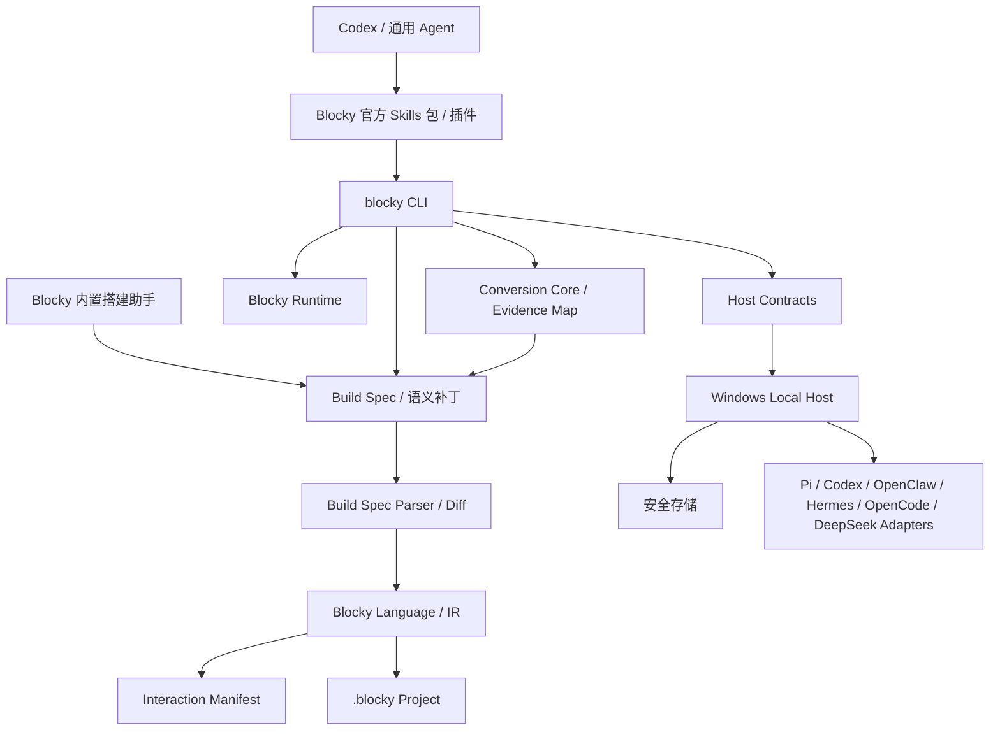

# ADR-003：Blocky CLI、官方 Agent Skills 与插件接口

| 项目 | 内容 |
|---|---|
| 状态 | 已接受，随 Blocky Core 尖峰分阶段实现 |
| 日期 | 2026-08-23 |
| 决策范围 | Windows CLI、内置搭建助手、多模块 Build Spec、Interaction Manifest、项目积木化、应用界面、RPA 检查、机器输出、官方 Agent Skills、官方插件、原生兼容命令 |
| 关联文档 | [完整积木与 Agent 兼容设计](../产品设计/Blocky-完整积木与Agent兼容设计.md)、[项目积木化与 Agent 组件设计](../产品设计/Blocky-GitHub项目积木化与Agent组件设计.md)、[多画布、应用界面与 RPA 设计](../产品设计/Blocky-多画布应用界面与RPA设计.md)、[CLI 产品设计](../产品设计/CLI与官方Agent-Skill.md)、[ADR-001](ADR-001-首版跨端技术选型.md)、[ADR-002](ADR-002-原生Agent兼容运行时.md)、[ADR-005](ADR-005-多模块应用界面与RPA边界.md) |

> 更新说明（2026-08-23）：原单一 `$build-blocky-agents` Skill 已扩展为四个官方 Skills 与 Codex 等客户端的插件；`$convert-github-project-to-blocky` 是核心项目积木化入口。本文定义的 CLI、Build Spec、输出、差异和授权契约由内置助手、全部 Skills 与插件共用；阶段 1 Demo 使用相同领域接口，不增加 Demo 专用 Schema 或运行旁路。

## 1. 背景

Codex 等通用 Agent 擅长理解需求和修改文本，但不能安全、稳定地直接构造 Project Manifest、任一模块 Blockly Workspace、Blocky IR 或 `.blocky` 容器。若只提供自然语言说明，不同 Agent 会编造积木 ID、遗漏权限、破坏未知字段或用隐藏代码代替画布中可见的程序。

因此 Blocky 需要四个协作层次：

1. Blocky 自有的极简搭建助手，在应用内解释、审阅或直接搭建积木。
2. 机器可组合、输出可预测、与桌面应用共享语义的 `blocky` CLI。
3. 基于开放 Agent Skills 格式的官方 Skills 包，分别承载搭建 Agent、创建积木、转换 GitHub 项目和逆向现有 Agent 的工作流与安全边界。
4. Codex 等客户端的官方插件，负责分发 Skills、发现 CLI 并连接本机 Blocky 图形页，不创建第二套语义或绕过授权。

## 2. 决策

- CLI 源码使用 TypeScript，位于未来的 `packages/cli`，直接依赖 `block-language`、`build-spec`、`interaction-manifest`、`runtime` 和 `host-contracts`。
- 新增 `packages/build-spec`，定义 Agent 可编辑的 YAML/JSON 交换格式、Schema、规范化、往返和差异模型；`packages/builder-agent` 只负责模型会话和调用这些受限工具，不自带第二套编译器。
- CLI 的纯本地命令直接调用共享 TypeScript 库；需要安全存储、真实模型、进程管理或原生兼容运行时的命令通过本地 Host 契约调用平台能力。
- Windows 正式安装包提供 `blocky.exe`/命令 shim 和随应用发行的运行环境；普通用户不需要另行全局安装 Node.js。具体封装方式通过尖峰决定，不在 ADR 中预设未经验证的单文件打包器。
- 官方 Skills 包至少包含 `build-blocky-agents`、`create-blocky-blocks`、`convert-github-project-to-blocky` 和 `reverse-agent-to-blocky`；OpenAI 专属 UI 元数据放在各 Skill 可选的 `agents/openai.yaml`。
- `convert-github-project-to-blocky` 必须先形成锁定源码快照和证据映射，再在自定义积木、可展开蓝图、兼容模板草案和原生保留报告之间作出可解释选择；它不能执行上游安装脚本或把仓库整体塞入不透明代码积木。
- 项目积木化、知识/RAG 和 Harness 分析共享 `conversion-core`，桌面 Demo、CLI 和官方 Skill 不得各自维护转换逻辑。
- Skill 不包含备用编译器或直接改项目的脚本；确定性操作全部调用已安装的 `blocky` CLI。
- CLI、桌面应用和兼容模板共享同一权限、权益和版本判断，不为 Agent 建立旁路。



## 3. 不选择的方案

| 方案 | 不选择原因 |
|---|---|
| 让 Agent 直接编辑 `.blocky` ZIP | 容易破坏 Workspace、IR、版本和来源映射的一致性 |
| 只提供自然语言 Skill，不提供 CLI | 无法确定性校验、差异、运行或限制输出，Skill 会变成长篇易漂移说明 |
| 先做 MCP、没有 CLI | 绑定支持 MCP 的宿主，不利于本地调试、脚本组合和跨 Agent 使用 |
| CLI 自带另一套积木目录与编译器 | 会和桌面应用产生语义漂移与权益旁路 |
| 官方 Skill 自带生成脚本 | 重复编译逻辑，并让不同 Skill 版本产出不同项目语义 |
| 将所有命令默认连接常驻服务 | 增加基础创建/校验的安装与故障面；纯本地操作应可独立完成 |

MCP 可在 CLI 与契约稳定后作为可选薄适配层，但不成为第一阶段基础依赖。

## 4. 目录规划

```text
packages/
  build-spec/
    src/
    schemas/
    test-fixtures/
  cli/
    src/
      commands/
      output/
      host/
    tests/
  conversion-core/
    schemas/
    evidence/
    test-fixtures/
  builder-agent/
  interaction-manifest/
integrations/
  agent-skills/
    build-blocky-agents/
    create-blocky-blocks/
    convert-github-project-to-blocky/
    reverse-agent-to-blocky/
```

正式实现时，`SKILL.md` 不附带 README、安装指南或变更日志；用户文档留在 Blocky 产品文档，Skill 包只保留 Agent 执行任务所需内容。

## 5. Build Spec 数据模型

### 定位

Build Spec 是 Agent 编辑格式；`.blocky` 仍是用户项目格式，Project Manifest 与每模块 Workspace 仍是编辑事实，Module/Project IR 是派生执行事实。转换链：

```text
Build Spec → Schema 校验 → 语义校验 → Module/Project IR → 每模块 Workspace 自动布局 → .blocky
.blocky → Manifest/Workspace/IR 一致性校验 → Build Spec + 保留区
```

### 根结构

```ts
type BuildSpec = {
  apiVersion: "blocky.ai/v1alpha1";
  kind: "BlockyProject";
  metadata: {
    name: string;
    description?: string;
    labels?: Record<string, string>;
  };
  target: {
    runtime: "blocky" | "openclaw" | "hermes" | "pi" | "opencode";
    compatibility?: CompatibilityTarget;
  };
  modules: Array<{
    id: string;
    name: string;
    purpose?: "agent" | "automation" | "service" | "rule" | "data";
    program: BuildBlock[];
  }>;
  interactions: InteractionEntrySpec[];
  tools: ToolDefinitionSpec[];
  customBlocks: CustomBlockSpec[];
  permissions: PermissionDeclaration[];
  appSurfaces: AppSurfaceSpec[];
  preserved?: PreservedOriginData;
};
```

### 规则

- `modules[].program` 使用树结构表达嵌套和顺序；不暴露 Blockly 坐标与内部连接对象。
- 模块使用稳定 ID，跨模块引用保存 `moduleId`/`exportId`；旧 `BlockyProgram` 只作为显式迁移输入，不作为正式多模块事实源。
- `BuildBlock.type` 必须解析到当前目录的版本化能力 ID。
- `BuildBlock.id` 在往返和修改中稳定；新 ID 由 CLI 生成或校验唯一性。
- 参数值使用积木 Schema 定义的类型，不允许任意表达式或内嵌 JavaScript。
- 六类首批原生兼容运行时的来源映射放入受控 `preserved` 区，Agent 默认只读。
- `interactions`、`tools` 与 `customBlocks` 是积木语义的可读投影，仍须编译到相同 Blocky IR；不得把交互能力或工具权限藏在无法从画布定位的旁路配置中。
- `appSurfaces` 默认空，只有显式页面计划被接受后才增加；标签顺序、浏览器视口和最近关闭标签不属于 Build Spec。
- 代码自定义积木必须声明输入、输出、错误、权限、沙箱和运行目标；Build Spec 不接受无契约的任意代码片段。
- YAML 只是可读表示，规范化哈希以 canonical JSON 计算。
- Spec 的破坏性变更提升 `apiVersion` 并提供显式迁移命令。

### 并发与差异指纹

`project diff` 返回：

- 当前项目内容哈希 `baseDigest`。
- 规范化 Spec 哈希 `specDigest`。
- 差异指纹 `diffDigest`。
- 新增、修改、移动、锁定、删除的积木列表。
- 权限、权益、运行时与原生写回影响。

`project apply` 必须同时提交这三个摘要。当前项目变化、Spec 变化或 CLI 版本导致重新解释时返回 `PROJECT_CONFLICT`，不覆盖文件。

## 6. CLI 架构

### 命令层

每个命令是薄适配器：解析参数、调用领域服务、通过统一输出层返回结果。禁止在命令处理器里复制编译、权限或兼容逻辑。

建议模块：

```text
commands/doctor
commands/schema
commands/catalog
commands/template
commands/project
commands/convert
commands/surface
commands/rpa
commands/run
commands/compat
commands/agent-skill
```

### 本地纯函数命令

以下命令不要求 Blocky UI 或 Host 运行：Schema、目录快照、模板读取、项目创建、模块/导出检查、导出 Spec、差异、结构校验、迁移检查、模拟运行、AppSurface 计划/差异、RPA 结构检查，以及对本地锁定仓库快照的转换检查、规划和确定性基准。

目录与模板来自随 CLI 发行、带版本的 Core 资源。`doctor` 比较 CLI 与桌面应用版本并说明是否可以安全往返。

### 项目积木化领域契约

`conversion-core` 提供 `snapshot`、`inspect`、`plan`、`benchmark`、`diff`、`apply` 六个领域操作。CLI、桌面阶段 1 Demo 和官方 Skill 都调用这些操作，不通过 UI 状态或提示词传递隐藏语义。

规划结果至少包含：

```ts
type ConversionPlan = {
  schemaVersion: "blocky.conversion/v1alpha1";
  sourceSnapshotDigest: string;
  catalogVersion: string;
  outputs: Array<{
    kind: "custom-block" | "blueprint" | "compat-draft" | "native-preservation";
    evidenceRefs: string[];
    specRef?: string;
    permissions: string[];
    performanceBudgetRef: string;
  }>;
  blocked: Array<{ code: string; evidenceRef?: string }>;
  unknown: Array<{ path: string; reason: string }>;
};
```

`apply` 必须携带源码快照、目录、计划和差异摘要；任一摘要变化均返回冲突。远程仓库获取、认证仓库和共享缓存属于 Host 操作；本地锁定快照的检查、规划、差异和确定性基准可纯本地执行。阶段 1 不定义 `demoMode` 或任何演示专用字段。

### Host 命令

真实模型、安全存储、运行进程、AppSurface 构建/预览、RPA 应用操作、六类原生兼容运行时、远程仓库获取和短期授权通过 `host-contracts`。Windows 优先采用当前用户范围的命名管道：

- 命名管道 ACL 只允许当前用户。
- 每次连接完成协议版本、实例 ID 和随机挑战握手。
- Host 不信任 CLI 传入的文件路径、权限或授权状态，全部重新校验。
- 不默认监听 TCP 端口；远程运行使用 ADR-002 的单独安全连接。

若 Host 未启动，读取/编译类命令继续可用；需要 Host 的命令返回 `HOST_UNAVAILABLE` 和明确恢复提示，不静默降级为不同语义。

## 7. 输出协议

### JSON Envelope

```ts
type CliResult<T> = {
  schemaVersion: "blocky.cli/v1";
  ok: boolean;
  command: string;
  data?: T;
  warnings: CliWarning[];
  artifacts: ArtifactRef[];
  nextCursor: string | null;
  error?: {
    code: string;
    message: string;
    path?: string;
    hint?: string;
    retryable: boolean;
  };
};
```

### JSONL Event

```ts
type CliEvent = {
  eventVersion: "blocky.event/v1";
  runId: string;
  sequence: number;
  type: string;
  blockId?: string;
  timestamp: string;
  data: Record<string, unknown>;
};
```

事件按 `sequence` 严格递增，`run watch --after <sequence>` 支持续读。敏感字段在进入输出层前统一脱敏，不能依赖每个命令自行处理。

### 输出预算

- 列表默认 `limit=20`，最大值由 Schema 声明。
- 完整配置、日志、轨迹和大 JSON 写到用户指定或 CLI 临时导出目录；返回绝对路径、媒体类型、字节数和 SHA-256。
- 默认文本输出面向人；Agent Skill 一律优先请求 `--json`/`--jsonl`。
- stderr 只放诊断，`--json` 模式也不能混入进度动画或 ANSI 字符。

### 稳定退出码

| 退出码 | 含义 |
|---:|---|
| 0 | 成功 |
| 2 | 参数/用法错误 |
| 3 | Schema 或语义校验失败 |
| 4 | 权限、授权或权益不足 |
| 5 | 并发修改或版本冲突 |
| 6 | Host/运行时不可用 |
| 7 | 部分完成，需检查响应 |
| 10 | Blocky 内部错误 |

## 8. 写入与审批协议

### 本地项目

- 创建新文件需要明确输出路径；存在时拒绝覆盖。
- 修改现有项目必须先取得最新 diff 指纹。
- `--force` 只能处理用户已明确要求的目标文件覆盖，不能跳过 Schema、类型、权益和权限校验。
- 应用采用同目录临时文件、完整校验、原子替换；失败不破坏原项目。

### 外部副作用

真实模型本身不一定产生外部副作用，但所有项目声明的文件写入、消息发送、删除、发布、设备动作、原生配置写回等必须进入运行计划。

Blocky UI/Host 在用户确认后创建：

```ts
type ApprovalRef = {
  id: string;
  planDigest: string;
  capabilities: string[];
  resourceScopes: string[];
  expiresAt: string;
  singleUse: true;
};
```

CLI 只传引用 ID，真实授权内容存于 Host 安全存储。Host 校验计划摘要、作用域、过期时间和单次使用状态。不存在通用 `--yes`、永久授权或由 Skill 自动签发的路径。

### 内置搭建助手的应用协议

搭建助手只获得目录查询、项目检查、语义补丁、布局建议、校验、模拟和差异读取等 Blocky 专用工具，不取得任意文件系统或底层项目直写能力。

- **审阅模式（默认）**：助手提交以 `baseDigest` 为基准的语义补丁；应用显示幽灵积木或差异，用户可逐项或整组接受、拒绝。
- **直接搭建模式**：应用先为本轮创建可撤销检查点，再应用补丁、重新编译和校验；用户可以整轮撤销。
- 项目在助手思考期间变化时，补丁返回 `PROJECT_CONFLICT`，要求助手重读后重新计划。
- 两种模式都不能绕过权限、原生写回或真实副作用确认；“直接搭建”只授权画布语义修改。
- 搭建助手的模型、会话、附件、上下文和工具结果与用户作品 Agent 完全隔离。

## 9. Agent Skill 规范

### 基础兼容层

每个官方 Skill 的 `SKILL.md` 仅使用开放标准要求的 `name` 和 `description` frontmatter，目录与名称一致。核心正文保持简洁并采用命令式说明。首批四个 Skill 各自承担独立入口，但复用同一 CLI、Schema、积木目录、权限和兼容协议：

- `build-blocky-agents`：从需求搭建或修改 Agent。
- `create-blocky-blocks`：创建可视化或代码自定义积木及其完整契约。
- `convert-github-project-to-blocky`：核心项目积木化入口；锁定源码证据，优先复用通用积木，并输出自定义积木、可展开蓝图、兼容模板草案或原生保留报告。
- `reverse-agent-to-blocky`：以证据表逆向现有 Agent，优先复用通用积木并输出覆盖与保留报告。

详细材料一层引用：

- `references/cli-reference.md`：当前稳定命令和输出码。
- `references/build-spec.md`：Schema、字段选择和示例。
- `references/compatibility.md`：Pi、Codex、OpenClaw、Hermes、OpenCode、DeepSeek Harness 流程与兼容等级表述。
- `references/conversion.md`：仓库快照、证据映射、RAG 通用积木、产物选择、许可证和性能边界。
- `assets/examples/`：可复制的无密钥 Spec 模板。

### OpenAI 扩展层

可选 `agents/openai.yaml` 只包含从 Skill 内容生成的：

- `display_name`
- `short_description`
- `default_prompt`

除非后续明确引入 MCP 或其他工具依赖，不声明不存在的依赖。它不改变 Skill 的隐式触发和安全工作流。

### 触发和非触发边界

触发：Blocky 项目创建/修改/解释/调试、自定义积木、自然语言转积木、`.blocky` 检查、GitHub 项目积木化，以及六个首批内置模板或其他现有 Agent 的逆向与兼容报告。

不触发：不要求 Blocky 产物的普通上游项目开发、与 Blocky 无关的一般 Agent 架构讨论、仅询问其他可视化工作流工具。

### 必须遵守

- 先运行 `blocky doctor --json`，再查询目录或模板。
- 不凭 Skill 静态内容编造积木 ID、参数或版本。
- 不直接编辑 `.blocky`、Blockly JSON、IR 或上游原生目录。
- 转换前锁定仓库/ref/子目录/许可证并生成证据表；默认不执行仓库代码、依赖安装或构建脚本。
- 对知识/RAG 优先映射通用来源、同步、解析、分段、Embedding、索引、检索、重排、压缩和引用积木，不生成框架品牌核心块。
- 新建后校验并模拟；修改前检查、导出、差异，修改后复验。
- 未获得真实运行或写回授权时，停在计划、差异或模拟结果。
- 返回文件路径、摘要、权限和未验证项，不粘贴巨型 JSON。

## 10. Skill 安装与供应链

应用内置 Skills 包作为只读发行资源，每个 Skill 的发布清单至少包含：

```json
{
  "name": "build-blocky-agents",
  "version": "0.1.0",
  "minCliVersion": "0.1.0",
  "source": "blocky-official",
  "files": [{ "path": "SKILL.md", "sha256": "..." }]
}
```

`agent skill verify` 分别报告：格式有效、内容哈希匹配、发行清单匹配、来源签名状态。没有签名基础设施时明确显示“哈希匹配，来源未签名”，不能使用“官方验证通过”。

安装流程：

1. 识别客户端和目标 scope。
2. 生成目标路径与文件差异。
3. 检查同名目录是否由 Blocky 管理、是否有用户改动。
4. dry-run 输出计划。
5. `--apply` 后只写计划列出的文件。
6. 重新读取并校验 Skill。

Codex 仓库级目标遵循其官方 `.agents/skills` 发现路径；其他客户端只在兼容矩阵明确记录后加入适配器。未知客户端使用 `skill export`，不猜测安装路径。

## 11. 版本策略

- `blocky.cli/v1`：机器响应协议。
- `blocky.event/v1`：运行事件协议。
- `blocky.ai/v1alpha1`：首个 Build Spec；在用户数据验证前保持 alpha。
- CLI 与 Core 使用同一发布版本，响应中仍分别报告版本以诊断不匹配。
- 每个官方 Skill 有独立语义版本和 `minCliVersion`/`maxTestedCliVersion`。
- CLI 读取更高版本 Spec 时默认拒绝写入；只读检查可返回未知字段摘要。
- 桌面应用与 CLI 使用共同 golden fixtures，不能各自维护迁移结果。

## 12. 测试策略

### CLI

- 参数解析与退出码表驱动测试。
- JSON/JSONL Schema golden tests，确保 stdout 无污染。
- 大列表分页、cursor 失效和大对象文件导出测试。
- 项目积木化的快照固定、增量扫描、证据映射、产物选择、许可证阻塞、取消恢复和大工件引用测试。
- 普通组件→自定义积木、RAG→可展开蓝图、Harness→兼容草案及不可转换→阻塞报告的 golden fixtures。
- Build Spec → IR → Workspace → `.blocky` → Spec 往返属性测试。
- 交互入口 → `InteractionManifest` → 桌面/移动输入栏的确定性投影测试。
- Tool 定义、Tool Reference、显式调用和结果访问共享契约的往返测试。
- 可视化与代码自定义积木的类型、权限、沙箱和未知实现保留测试。
- 稳定积木 ID、未知字段保留和并发摘要冲突测试。
- 临时文件、原子替换、中断和磁盘空间不足测试。
- 密钥、Token、Cookie、Authorization Header 和私有路径脱敏测试。
- Windows 安装后从源码目录外运行 `blocky --version`、`doctor` 和完整本地闭环。

### Host 与审批

- 命名管道当前用户 ACL、协议握手和拒绝跨用户访问测试。
- 过期、错误摘要、错误作用域、重复使用和伪造授权引用测试。
- Host 不可用、重启、运行时崩溃和断线恢复测试。

### Skills 与搭建助手

- 使用标准验证器逐个检查四个 Skill 的名称、frontmatter、目录与引用。
- 在无父对话泄漏的干净 Agent 会话中前向测试。
- 至少覆盖：新建基础项目、修改已有项目、创建两类自定义积木、GitHub 项目积木化、六类首批模板只读导入、现有 Agent 逆向、拒绝未授权真实运行。
- GitHub 项目积木化在干净 Agent 会话中分别验证组件、RAG、Harness 和阻塞四种结果；Codex/OpenClaw 可使用锁定源码夹具，Claude Code 在专项审计前只使用公开配置/扩展/行为夹具。
- 核验 Agent 是否先发现目录、保持输出简洁、返回真实产物路径且不虚构通过结果。
- 搭建助手分别验证审阅模式逐项接受，以及直接搭建模式逐轮检查点、冲突拒绝和整轮撤销。
- Codex 作为首个正式目标；另一兼容客户端通过后才能宣传跨客户端复用。

## 13. 实施顺序

1. 在正式 monorepo 的阶段 1 Demo 中定义最小多模块 Build Spec、转换领域接口、显式 AppSurface 夹具和本地锁定 fixture，不加入 Demo 专用字段。
2. 稳定语言 v1、Project Manifest 和跨模块引用，并实现只读目录、项目/模块创建、导出、差异、校验、模拟运行和本地 convert CLI。
3. 完成真实知识/RAG 与项目积木化领域服务，再开放网络快照和供应链门禁。
4. 验证 Windows 从任意目录调用、结构化输出、大工件和取消恢复。
5. 实现内置搭建助手的审阅模式、显式应用界面 plan/diff/apply，再加入带逐轮检查点的直接搭建模式。
6. 用真实 CLI 行为生成四个官方 Skills、引用和示例，优先前向测试 `$convert-github-project-to-blocky`。
7. 加入本地 Host、真实模型和短期授权引用。
8. 接入 ADR-002 六套适配器，依次开放兼容读取、报告和经授权写回；Claude Code 先保留研究 fixture 地位。
9. 阶段 7 加入有人值守 RPA inspect/validate/recording-import；实际应用操作始终通过桌面 Host 授权，阶段 11 前不开放无人值守 Worker 命令。

禁止先发布一个只靠提示词猜积木结构的“官方 Skill”；Skill 正式可用必须以经过验证的 CLI Core 为前置。

## 14. 官方依据

- OpenAI 官方 Skill 构建与 Codex 发现路径：<https://learn.chatgpt.com/docs/build-skills>
- OpenAI 官方 Agent 友好 CLI 工作流：<https://learn.chatgpt.com/use-cases/agent-friendly-clis>
- Agent Skills 开放标准概览：<https://agentskills.io/home>
- Agent Skills 格式规范：<https://agentskills.io/specification>
- Codex 开放仓库、Claude Code 扩展能力与 OpenClaw Tools：<https://github.com/openai/codex>、<https://code.claude.com/docs/en/features-overview>、<https://docs.openclaw.ai/tools>
- LangChain Retrieval 与 Qdrant 混合查询/生产优化：<https://docs.langchain.com/oss/python/langchain/retrieval>、<https://qdrant.tech/documentation/search/hybrid-queries/>、<https://qdrant.tech/documentation/production-checklist/>
