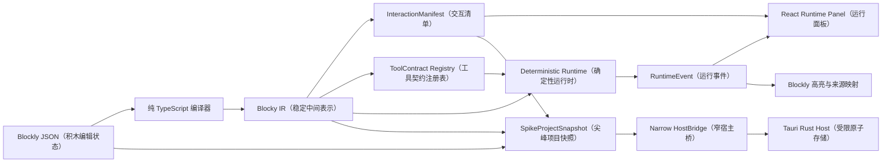

# Windows Core 技术尖峰报告

## 结论摘要

| 项目 | 结论 |
|---|---|
| 验收日期 | 2026-08-10 |
| 验收对象 | `codex/feat-windows-core-spike` 分支；原始全量基线 `7eeb9a8e0974b4356e24abf80c3ade46d486af6e`，冻结契约补充提交 `642f06cb59420031925c47ee801505656e50ccf8` |
| 独立复审 | L3（核心执行与本地数据边界）通过；Critical（严重）0 / Important（重要）0 / Minor（次要）0 |
| 技术决策 | **GO（继续）**：八项 Windows Core（Windows 核心）门禁全部通过，可以开始设计正式 monorepo（单体仓库）与共享包 |
| 决策边界 | 不授权整包复制尖峰、不代表正式产品、发行、上架、收费或完整 311 块支持，也不验证 ADR-001 第二、第三阶段 |

本报告记录的是位于 `try/windows-core-spike/` 的一次性 Windows 原生技术尖峰。原始全量测试提交为 `7eeb9a8`；随后 `22f9778` 与 `642f06c` 恢复并补齐冻结的 IR（中间表示）、运行事件与 Host（宿主）请求契约，已重新通过聚焦、Fast、Core、原生 E2E（端到端）、性能、日志审计和普通包隔离。旧的 30 分钟长稳仍只绑定其原始 full（完整）运行，不冒充在补充提交上重新执行。包含本报告的后续文档提交只固化证据与结论，不替代测试提交。

## 1. 机器与锁定工具链

测试机器为 Microsoft Windows 11 家庭版（版本 `10.0.26200`、64 位），处理器 Intel Core Ultra 9 275HX（英特尔酷睿 Ultra 9 275HX）、24 个逻辑处理器、可见内存约 63.4 GiB（吉比字节）。原生性能运行中的 WebView（网页视图）用户代理为 Edge/WebView2 151（Chromium 151）。

| 类别 | 锁定版本 |
|---|---|
| 系统运行时 | Node.js（JavaScript 运行时）22.23.1、pnpm（包管理器）10.23.0、Rust（系统语言工具链）1.95.0、Cargo（Rust 构建器）1.95.0 |
| 桌面壳 | Tauri CLI（命令行）2.11.4、Tauri crate（Rust 包）2.11.5、`@tauri-apps/api` 2.11.1 |
| 前端 | React（界面框架）19.2.8、TypeScript（类型语言）7.0.2、Vite（构建器）8.2.1、Blockly（积木编辑器）13.2.1、Zod（数据校验）4.4.3 |
| 测试 | Vitest（测试框架）4.1.10、WebdriverIO（浏览器驱动测试）9.30.1、`@wdio/tauri-service` 1.3.0、`@wdio/tauri-plugin` 1.3.0 |

## 2. 范围与排除项

本次只验证 ADR-001 第一阶段八项 Core（核心）门禁：本地 Blockly、精确 100 积木编辑/保存、稳定 IR（中间表示）、双标签与入口投影、一等 Tool（工具）契约、确定性运行时、受限 Tauri Host（宿主）以及原生 Windows E2E（端到端）、性能、长稳和敏感信息边界。

明确未实现或未验证：正式 Blocky 应用骨架、完整 311-ID（标识符）目录、产品内置的真实模型/插件适配器、搭建助手、账号、订阅、权益、社区、CLI（命令行）、官方 Skills（技能）、四类原生 Agent（智能体）适配器、自定义积木、正式 `.blocky` 容器、安装器/签名/商店资源、macOS、Android、HarmonyOS、iOS 和商业发布。用户授权的 DeepSeek Flash 外部兼容性探针已作为补充验收通过，但它没有被接入产品构建、配置或持久化路径。

## 3. 验证架构

关键边界如下：

- Blockly JSON 是编辑事实，运行只读取版本化 IR；视觉坐标、折叠状态等不污染语义结果。
- `InteractionManifest` 是右栏能力的唯一来源；界面不扫描工作区猜测输入能力。
- Agent 附着和显式调用都以稳定 `toolId` 解析同一只读 `ToolContract` 对象。
- Rust Host 只接受受限 `projectId` 与经验证 JSON，不接受前端提供的任意路径。
- WDIO（WebdriverIO 测试通道）只进入独立测试 feature（特性）/mode（模式）/capability（能力）；普通 release（发布构建）保持隔离。

## 4. 八项 Core 门禁证据

| # | 门禁 | 自动化与原生证据 | 人工证据 | 结果 |
|---:|---|---|---|---|
| 1 | 安装包本地加载 Blockly | release EXE（发布可执行文件）断网运行；本地 `blockly-media/sprites.svg`；出站 `fetch`、`XMLHttpRequest`、`WebSocket` 尝试账本为 0 | 正常 EXE 打开工具箱；进程连接检查 `Established=0`、`ExternalEstablished=0` | 通过 |
| 2 | 不少于 100 块编辑与保存 | 夹具精确 100 块/100 IR 节点；原生保存使用唯一 sentinel（哨兵）并核对 JSON、SHA-256 与字节数，关闭重开后 ID 完整 | 拖动 10 块、有效/无效连接、三类容器折叠/展开、缩放/重置、100 块关闭重开 | 通过 |
| 3 | 稳定 IR 与画布回映 | 相同语义的工作区稳定序列化；运行事件 `blockId` 只指向 source map（来源映射）中的真实节点；原生高亮断言 | 权限等待、取消、错误和完成状态中，高亮与事件时间线一致 | 通过 |
| 4 | 双标签与无入口禁用 | 组件及原生 E2E 验证搭建助手/运行 Agent 双标签、无入口禁用和生命周期边界 | 清空/重开时运行入口与提示符合当前清单 | 通过 |
| 5 | 六种入口能力由清单同步 | 零/单/多入口、重命名/重排、独立草稿及 text/image/file/voice/Skill/plugin（文本/图片/文件/语音/技能/插件）投影测试 | 增删六种能力并切换两个入口，右栏控件同步 | 通过 |
| 6 | Tool 引用与显式调用共享契约 | 两种用法严格解析到同一对象身份；参数变更同步影响附着与调用；无显示名回退 | Tool 名称、参数与权限展示一致 | 通过 |
| 7 | 流式、取消、错误和权限 | 确定性两段流；单调事件序号；`/error`、取消、权限拒绝/批准均有唯一终态 | 正常、取消、安全错误、权限拒绝与批准全部可见 | 通过 |
| 8 | 项目与日志敏感扫描为零 | `SENSITIVE_SCAN tracked=0 snapshot=0 frontend_log=0 backend_log=0`；WDIO 应用诊断、敏感值和绝对工作区路径均为 0；含 NUL（空字符）文本缺口已失败关闭 | 项目 JSON 与事件面板未出现明文秘密或绝对路径 | 通过 |

详细命令、退出码和验收等级见[任务验收记录](../验收/归档/2026-08-10/验收-Windows-Core技术尖峰.md)。

### 4.1 DeepSeek Flash 外部兼容性补充验收

用户明确授权后，独立子 Agent 使用本地进程环境临时读取凭据，对 `deepseek-v4-flash` 执行限定的 live（在线）兼容性探针。当前有效的冻结契约后复验严格只访问 `api.deepseek.com`，共 4 个小请求且均为 HTTP 200：模型列表 133 ms、固定文本 1162 ms、工具调用第一轮 76 ms、合成工具结果后的第二轮 70 ms。Chat 请求按官方 [Chat Completion API](https://api-docs.deepseek.com/api/create-chat-completion) 显式关闭 thinking（思考），工具链路遵循官方 [Tool Calls 指南](https://api-docs.deepseek.com/guides/tool_calls)。

固定文本经现有依赖注入边界进入 deterministic runtime（确定性运行时），得到 `run.started -> block.started -> model.chunk -> block.completed -> run.completed`；每个事件均带 `blocky.event/v0-spike`、连续序号、同一运行标识和有效 source map（来源映射），且只有一个完成终态。工具两轮验证了工具名、JSON 对象参数、无额外字段和 `tool_call_id` 链接；工具结果只在本地合成，没有执行真实外部工具副作用。

这项结果只说明外部 API 与当前最小 model/tool seam（模型/工具接缝）兼容，不代表产品已内置 DeepSeek、已实现生产适配器、已验证服务可用性 SLA（服务等级）或已授权任何真实工具动作。详细命令边界、Token（令牌）计数、秘密处理和独立复审见[补充任务验收](../验收/归档/2026-08-10/验收-DeepSeek-Flash-Agent补充验证.md)。

## 5. 性能与 30 分钟长稳

性能测试在原生 WebView 内以 `performance.now()` 计时，一次不计时预热后保留 5 个样本；每个样本均为 100 个 Blockly 块与 100 个 IR 节点。

| 操作 | 原始样本（毫秒） | 中位数 | 阈值 | 结果 |
|---|---|---:|---:|---|
| 加载 Blockly JSON | `19`、`14.400000000372527`、`14.200000000186265`、`17.700000000186265`、`19.200000000186265` | `17.700000000186265 ms` | `<= 1500 ms` | 通过 |
| 确定性运行 | `0.10000000055879354`、`0`、`0.09999999962747096`、`0.10000000055879354`、`0` | `0.09999999962747096 ms` | `<= 1500 ms` | 通过 |
| 保存并编译 | `0.6999999992549419`、`0.8000000007450581`、`0.599999999627471`、`3.900000000372529`、`0.1999999992549419` | `0.6999999992549419 ms` | `<= 750 ms` | 通过 |

独立完整长稳结果：`cyclesCompleted=360`，`elapsedMs=1803033`（30 分 03.033 秒），`saveReloadsCompleted=30`；cycle（循环）60 的 `warmHeapBytes=8682986`，cycle 360 的 `finalHeapBytes=8979466`，`heapDeltaBytes=296480`，远低于 32 MiB（兆二进制字节）阈值。每 12 个循环的 Host 原子保存时间持续推进；应用诊断、敏感匹配和绝对工作区路径均为 0。

该完整长稳由独立 reviewer（复审者）在 `5c5fde9` 运行；随后 `7eeb9a8` 只修改仓库扫描脚本及其单元测试。最终独立复审确认 runtime（运行时）、UI（界面）、Host（宿主）与 soak（长稳）代码未变，并在 `7eeb9a8` 新鲜运行 `check` 与 `check:core` 通过，因此接纳这组 30 分钟原始证据；没有把它表述成在 `7eeb9a8` 再跑的一次新 soak。

## 6. 权限、CSP 与秘密边界

- 普通构建 `withGlobalTauri=false`；唯一 capability（能力）是 `main`，只含 `core:default`。
- 普通构建的 CSP（内容安全策略）只允许本地 `self`、`asset:`、`data:` 与固定 Tauri IPC（进程间通信）地址 `ipc:` / `http://ipc.localhost`；不允许远程脚本、样式或连接。
- 最终隔离摘要为 `NORMAL_ISOLATION markers=0 cargo_wdio=0 capability=main`。
- 运行事件在唯一出口脱敏；Rust Host 对项目 ID、5 MiB 大小、JSON schema（模式）、派生数据和敏感字符串失败关闭，并以原子写入持久化。
- 首轮独立验收发现含 NUL 的、仍可由 TypeScript 7.0.2 编译的文本会被旧扫描器跳过。`7eeb9a8` 改为按明确二进制扩展分流，严格解码 UTF-8/UTF-16 BOM（字节序标记）文本、递归扫描 JSON 字符串值，并用 `unsafe-text-nul`、`text-decoding-error`、`invalid-json` 固定类别失败关闭。最终独立矩阵 21/21、正式回归 16/16 通过且匹配值不回显。
- Codex Security（安全扫描）最终差异扫描为 0 个可报告发现项、coverage complete（覆盖完整）、0 deferred（延后）；CodeRabbit CLI（代码审查命令行）未安装，`coderabbit --version` 返回 `The term 'coderabbit' is not recognized`（命令未识别），按约束未安装，也未将人工审查冒充为 CodeRabbit 结果。

## 7. 人工与视觉验收

下列 8 张关键 PNG（便携式网络图形）已从忽略目录复制到 Git 跟踪文档目录，避免临时报告成为唯一证据。逐图检查未见密钥、绝对路径或账号值；部分截图左下带有无关 Codex 桌面通知，不覆盖被验收控件，属于证据视觉卫生限制。权限批准完成链由原生 E2E、事件断言和人工验收记录共同证明，不使用无法直接显示完整批准链的截图冒充视觉证据。

| 场景 | 持久证据 | SHA-256 |
|---|---|---|
| 普通 release 的正式批准 Windows Logo（标识） | [01-logo-normal-release.png](./Windows-Core视觉验收/01-logo-normal-release.png) | `6F1F8E8D46E96610348A5E43498B80118D570E6569DE2E1A42F53D334E857588` |
| 10 块、至少四分类 | [02-manual-10-blocks.png](./Windows-Core视觉验收/02-manual-10-blocks.png) | `89EFC3E72FB4FDE955B81DF4B90BFD15ED69949E039A5647A27483413F19D9CF` |
| 有效 JSON（对象表示）连接 | [03-valid-json-connection.png](./Windows-Core视觉验收/03-valid-json-connection.png) | `4A3F9C9B6264643A6EA4BD7A8D7FA6D9C157CC1CA3CD4A6CFE34D5CA5C13B481` |
| 非法 Boolean→JSON（布尔到对象表示）连接被拒绝 | [04-invalid-boolean-json-rejected.png](./Windows-Core视觉验收/04-invalid-boolean-json-rejected.png) | `FEAD5BCA9D299A4673D925B8848F47668797C2A54CCD79DEF94AF985F21B78F6` |
| 放大、缩小后重置 | [05-zoom-reset.png](./Windows-Core视觉验收/05-zoom-reset.png) | `AF1374348D7640376F9AC2210C9DD9AC862BCC37BF6BDE8F79471604394F90D1` |
| 100 块保存、关闭、重开并重载 | [06-100-blocks-reopened.png](./Windows-Core视觉验收/06-100-blocks-reopened.png) | `D250EEFA9A818CB38CABE8B544C59D64F12EBC5E1F81396F22FEC8045C08DFFA` |
| 右栏六种能力控件与正常运行完成 | [07-six-capabilities.png](./Windows-Core视觉验收/07-six-capabilities.png) | `76B99E70F4B1A73C45EB1E64A05ADB13E7BF1F5C2EC70A62CD43D7496B26B641` |
| 权限等待、时间线与积木高亮 | [08-permission-pending-highlight.png](./Windows-Core视觉验收/08-permission-pending-highlight.png) | `6F9D1AD5C0DDE41AFE0AD6B268894FC2E09D162373731E257BAD341E0100AB08` |

批准源 `logo/logo.png` 为 1254 × 1254、SHA-256 `12D3F351006663FD07EFD11480101F3C06A43F91633F2E8A914888CA63CF0D9D`；Windows `icon.ico` 为 79,902 bytes（字节）、6 个图标条目、SHA-256 `CBBAE888F508EDBA2E051640D992ABB38752D5C9513B53EFE50E400F2C7DB69F`。32/64/128/512 像素 PNG 的 SHA-256 分别为 `193342E1F008436D9BB2ADCED8D9AB756194E71C55BCB086127181289C3F108F`、`D9335F27BE613F55DD0E493BA3186AC822D314EC2450438796275CCD39114205`、`050EFCC3FB45CBD4F1345BF46DA59227332E6C46B4D23F4395F0BE4B82EC3817`、`073E00081A5E1B3904642FD263CC66B29C41B49F61FD7E9027A4B63B43CB4BC7`；完整值由品牌资产契约测试锁定。

## 8. 已遇缺陷与修复

| 缺陷 | 修复与复核结果 |
|---|---|
| 工作区替换可能遗留正在运行或待审批的旧 run（运行） | 串行化替换边界，先取消/拒绝并等待结算；审批绑定 run token（运行令牌）、投影修订和工作区摘要；原 Important（重要）关闭 |
| 原生保存探针可能误收旧磁盘文件 | 先写唯一 sentinel，再要求 UI 保存产生不同且精确匹配的 JSON、SHA-256、字节数；原 Important 关闭 |
| 缩放只点击不观测 | 读取真实 Blockly 画布 scale（缩放比例），验证增大、减小和恢复；原 Minor（次要）关闭 |
| WDIO 日志 allowlist（允许清单）与秘密检测存在假阴性 | 锚定完整 provider（提供方）行，应用错误优先分类，复用八类敏感检测且不回显；原 Minor 关闭 |
| 空运行面板布局回退 | 区分纯空闲与生命周期状态，真实 CSS（样式表）验证居中、字体和可达的时间线/审批/取消；原 Minor 关闭 |
| 仓库扫描器把含 NUL 文本误作二进制跳过 | 严格文本解码与 JSON 语义扫描，失败关闭；最终独立复审 0/0/0 |
| 冻结 IR / RuntimeEvent / Host 请求形状发生漂移 | 恢复 `fields` / `inputs` / `next` 必填与显式 `null`，由唯一事件工厂写入 `eventVersion` 并限制 `data` 为对象记录，公开保存请求统一为 `{ projectId, json }`；聚焦 57/57、`check`、`check:core` 与安全差异扫描独立通过，原 Important 关闭 |
| 首次完整门禁出现一次 Vitest worker（测试工作进程）异常退出 | 未增加自动重试或抑制；同拓扑连续 3 次单元测试及后续独立 `check`、`check:core`、`check:full` 均通过，判定为一次性调度异常 |

既有 Vite 主压缩 chunk（代码块）大于 1000 kB 警告仍保留；当前实测性能通过，但正式仓库设计应安排 code splitting（代码拆分）。无 BOM 的 UTF-16 不做猜测解码，而是严格失败关闭，这是有意安全边界。

## 9. 工作区外行为与工具异常

- Task 8 首次严格 Clippy（Rust 静态检查）因组件缺失失败，`rustup component add clippy` 将组件写入 `C:\Users\29551\.rustup`；没有写入凭据或项目数据。
- WDIO embedded provider（嵌入式提供方）在 `C:\Users\29551\AppData\Local\Temp\msedgedriver\151-*` 创建每次运行的临时 Edge driver（浏览器驱动）目录。已记录但没有用户授权清理，因此保持原状。
- Task 10 reviewer（复审者）在 `C:\Temp` 使用的限定验证 sandbox（沙箱）已按精确目标删除；没有广泛清理 C 盘。
- Codex Security 在 `C:\Users\29551\AppData\Local\Temp\codex-security-scans-*` 写入扫描包与仓库范围威胁模型；它们是插件产物，不是项目文件。
- computer-use（计算机控制）在窗口激活与状态读取时均返回精确错误 `Error: node_repl exec context not found`；重置仍无效。后备只使用机器既有 pywinauto 0.6.9、Pillow 12.1.0、OpenCV 4.13.0.92 与 Win32/System.Drawing（Windows 原生绘图）能力，没有安装或升级依赖。
- 正常应用以进程级 WebView2 主机解析阻断方式离线运行；反复检查应用进程 `Established=0`、`ExternalEstablished=0`，没有修改系统网络适配器或全局防火墙规则。
- DeepSeek 补充验收只读取用户明确授权的本地凭据文件并把值注入短生命周期测试子进程；没有修改凭据文件、没有记录真实路径/值/请求头/响应正文，也没有把凭据写入 Git、报告或缓存。网络只访问 `api.deepseek.com`；探针和工作区内定向缓存已删除。
- 本阶段没有 push（推送）、PR（拉取请求）、发布、上架或其他 GitHub 外部写入。

## 10. GO 后果与正式仓库约束

本次 GO 只授权下一步设计正式 monorepo 与共享包边界，建议以实际尖峰依赖方向为输入，评审 `apps/desktop`、`packages/block-editor`、`packages/block-language`、`packages/interaction-manifest`、`packages/runtime`、`packages/host-contracts` 等职责，以及稳定版本号、迁移策略和跨包测试。

正式实现必须：重新评审 `v0-spike`/`v1` 临时契约；保留纯语义内核、Manifest 唯一投影、一等 Tool、窄 Host 和测试能力隔离；将可复用逻辑从 `try/` 逐项迁移并重新测试。不得把尖峰整体复制为产品，不得由本报告推出发行、收费、完整 311 块、第二阶段完整 Windows 能力或任何后续平台已通过。
